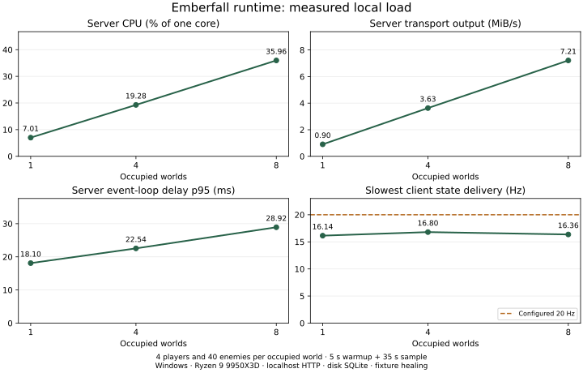

# Production runtime load measurements

Run from the repository root with Node 24 and pnpm 11:

```sh
pnpm benchmark:runtime
```

The command prints a JSON report to stdout and progress to stderr. It creates a
fresh child server and temporary on-disk SQLite database for each workload, then
closes its SDK connections/server and removes only its verified temporary
directory. It never accepts a player database path. An existing database is
rejected before server startup.

## Workload and ownership

The declarative [workload](../../packages/server/scripts/runtime-workload.ts)
defines 1, 4 and 8 occupied worlds, each with four connected players and 40 mixed
enemies. The normal empty permanent world is also included. Each world has one
four-player party, with Warrior, Ranger, Mage and Druid starters. Enemies have
high health to keep their count steady; no new waves or kill rewards are measured.
The fixture heals players every 250 ms without disabling damage or enemy AI.
Self-checks require live players, retained enemies, enemy damage and actual attacks.

The [worker](../../packages/server/scripts/runtime-worker.ts) uses the production
`createGameServer` factory, Miniplex simulation, viewer projection, Colyseus schema
encoding and SQLite WAL/FULL persistence. Fixture setup uses the existing runtime
maps and party operations over child IPC; it adds no HTTP endpoint or production
runtime hook. Steam authentication, TLS, external NPC generation, browser rendering
and public-network behavior are outside this measurement. The isolated provider
returns busy; forest players do not exercise village conversation generation.

The [SDK driver](../../packages/server/scripts/runtime-clients.ts) sends validated
50 ms movement inputs at a nominal 20 Hz with monotonic sequence IDs and the
correct scene epoch. Automatic class attacks run in shared simulation. Five
seconds of warmup precede a 35-second sample. Each client must observe multiple
real autosaves, acknowledge inputs and remain live. Every measured state checks
world membership and a private chat marker addressed only to that viewer.

## Metrics

- Server CPU is child-process user plus system CPU divided by monotonic elapsed
  time. **100% means one CPU core**, not the entire machine. The SDK driver's CPU
  is recorded separately.
- Event-loop delay uses Node's 10 ms histogram; it is not a direct tick-duration
  measurement. RSS is recorded at the end and sampled every 250 ms for a peak.
- Transport output is the delta of public server `net.Socket.bytesWritten`
  counters after warmup, including closed sockets. It includes WebSocket framing
  and heartbeats, excludes TCP/IP overhead, and measures HTTP/WebSocket without
  TLS. JSON size is not used as a substitute for transport bytes.
- State frequency and server-time gaps come from received native schema updates.
  Input acknowledgement latency runs from SDK send to observing its sequence ID
  in state; it includes driver scheduling, server processing and transport.
- Startup, admission, warmup and shutdown are excluded from the sample. Normal
  five-second autosaves run inside it. Successful cleanup is required before a
  workload is included in the final report.

## Recorded results

The [raw report](runtime-results.json) records the exact clean source revision,
host, durations, workload and unrounded metrics. This is one local Windows run
on a Ryzen 9 9950X3D with 32 logical CPUs and about 64 GiB RAM, not a public-server
capacity limit or a before/after optimization claim.

| Worlds | Clients | CPU / one core | Peak RSS MiB | Loop p95 ms | Output MiB/s | Min state Hz | Input ack p95 ms |
| ------ | ------- | -------------- | ------------ | ----------- | ------------ | ------------ | ---------------- |
| 1      | 4       | 7.0%           | 287.0        | 18.1        | 0.90         | 16.14        | 79.2             |
| 4      | 16      | 19.3%          | 358.8        | 22.5        | 3.63         | 16.80        | 67.2             |
| 8      | 32      | 36.0%          | 376.9        | 28.9        | 7.21         | 16.36        | 96.1             |

Every client observed seven autosaves. All 30,162 measured state updates passed
world-membership and private-chat checks, with no reported connection or command
errors. The preliminary run and final run both passed their workload self-checks;
the table and chart use the final clean source revision recorded in the report.



The configured 20 Hz cadence and observed client cadence are shown separately.
The samples delivered fewer updates than the configured rate even at one occupied
world. Do not infer that adding a projection cache would restore 20 Hz: timer,
patch scheduling and transport need separate profiling before attributing this
gap to CPU saturation. These measurements do not justify sharding SQLite or
sharing viewer-private projections.

The existing `pnpm benchmark` remains a simulation/schema kernel microbenchmark,
not a production-server load test. Its seeded random source is now bound through
`createGame`, preserving the measured patch-byte and entity-count totals without
replacing global `Math.random`.

## Verification

The full load command includes workload, liveness, save, acknowledgement and
privacy assertions. [Native failure-path tests](../../packages/server/src/runtime-benchmark.test.ts)
also exercise existing-database refusal and client cleanup after server loss.
Repeat measurements on the intended deployment host before choosing capacity or
claiming a performance improvement; this report covers steady combat rather than
admission bursts, maximal talent effects, long sessions or generative-model load.
