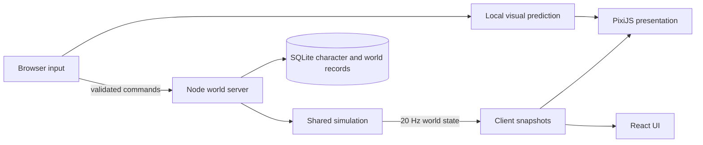

# System architecture

Status: implemented. Emberfall is online-only. One Node process owns worlds and simulation, React presents UI, PixiJS renders the world, Miniplex manages entities and Colyseus replicates state. The [runtime design](new-runtime.md) describes the sole runtime; the original implementation is retired.

## Packages and ownership

| Package           | Responsibility                                                                               | Main entry points                                                                                    |
| ----------------- | -------------------------------------------------------------------------------------------- | ---------------------------------------------------------------------------------------------------- |
| `packages/common` | Shared contracts, structural schemas, protocol state and pure geometry                       | [index.ts](../../packages/common/src/index.ts)                                                       |
| `packages/core`   | Registries, bundled mods, content-aware rules and shared combat/prediction                   | [index.ts](../../packages/core/src/index.ts), [simulation.ts](../../packages/core/src/simulation.ts) |
| `packages/server` | HTTP(S), Colyseus sessions, world directory, authoritative ticks and SQLite saves            | [index.ts](../../packages/server/src/index.ts), [worlds.ts](../../packages/server/src/worlds.ts)     |
| `packages/client` | Connection/recovery, preferences, input, prediction, PixiJS rendering and screen composition | [main.tsx](../../packages/client/src/main.tsx), [Arena.tsx](../../packages/client/src/Arena.tsx)     |
| `packages/ui`     | Controlled React/MUI presentation, theme, accessibility and Storybook                        | [public exports](../../packages/ui/src/index.ts), [component guide](../../packages/ui/README.md)     |

Node 24 executes server TypeScript during development. Vite builds the client and bundles the server with an SSR target. The Node HTTP/WebSocket application, not Vite, runs the multiplayer server. Turborepo coordinates workspace commands.

The client Vite build optimizes PNGs and emits Brotli/gzip companions for text assets.
See [development](../development.md) for pixel-preservation checks and [operations](../operations.md) for cache and deployment rules.

## Game composition

[Bundled mods](mods.md) implement [MOD-01–04](../specs/mods.md). Core creates
registries, registers the explicit bundled list, validates/seals content and
exposes ready rules before host startup. `mods/base.mod.ts` owns current content;
additional mods use the same API. Common stays independent of core. The
[mod plan](../plans/mods.md) records delivery and verification.

## Data flow

Local prediction improves perceived response; it never owns damage, health, death, loot or saved progress. High-frequency drawing uses animation frames and mutable presentation data rather than React updates per actor.

## Design map

- [Network and persistence](network-and-persistence.md): WORLD, CHAT and CHAR requirements; commands, session recovery, save format, validation and failure behavior.
- [Simulation](simulation.md): SCENE and COMBAT requirements; phase transitions, enemy scaling, shared hit paths, pause/resume and rewards.
- [Movement](movement.md): input acknowledgement, interpolation, wrapped geometry and predicted casts.
- [Presentation](presentation.md): UI and GRAPHICS requirements; settings, caches, audio, diagnostics and shared UI boundaries.
- [Operations](../operations.md): HTTPS, hosting, cache headers, backup and deployment.

## Change boundaries

Update a shared message schema, its server validation and client handling together when changing the wire contract. Persist only validated character progress and authorized world membership. Renderer-only changes must not alter gameplay geometry. Combat changes must cover both forest and training use of the shared simulation.

The current limits are eight players per world and bounded combat collections with Colyseus schema deltas. There is no measured large-horde scalability guarantee. Profile a concrete target before adopting batching, sharding or changing renderers.

The [progression specification](../specs/progression.md) covers implemented automatic levels, paragon and voluntary talents. Further progression changes must define server-owned data, transitions and migration after their behavior is selected.
