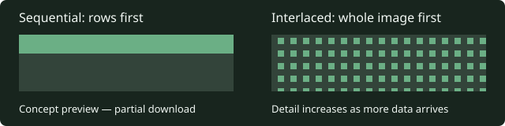

# Development and verification

Run commands from the repository root unless stated otherwise. Runtime setup and HTTPS requirements are in [operations](operations.md).

## Commands

The [Verify workflow](../.github/workflows/verify.yml) always runs formatting,
lint, typechecking, core and root Node suites, and builds on every pull request.
Pull requests also run affected desktop browser scenarios selected by
[browser selection](../scripts/ci-browser-tests.ts). Unmapped and shared-runtime
changes fall back to
the complete 11-file desktop baseline plus shared UI checks. Desktop allowlists
exclude existing mixed phone/touch scenarios.

For a release candidate, run **Actions → Verify → Run workflow** on
`main` (CLI: `gh workflow run verify.yml --ref main`). Manual runs always execute
the complete desktop baseline and shared UI checks. A successful manual run on
current `main` triggers Pages deployment of that exact SHA. Intermediate merges
do not repeat the PR run. A stale release is rejected before building and
before deployment. See [operations](operations.md#github-pages-client-with-a-server-on-your-machine).
Browser tests use disposable certificates/databases; failures retain CI artifacts.
Git checks text out with LF on every platform through `.gitattributes`.

```sh
pnpm install --frozen-lockfile
pnpm fmt:check
pnpm lint
pnpm typecheck
pnpm test
pnpm build
```

The formatter is Oxfmt; `pnpm fmt` writes formatting. `pnpm test` uses Node's test runner for `packages/server/src/*.test.ts`, and `tests/*.test.ts`, including shared simulation, client helpers and asset checks. Build includes client, server and the static UI Storybook through Turborepo. The [GitHub Pages workflow](../.github/workflows/deploy-pages.yml) builds and deploys the fully verified client after a successful manual Verify run on current `main`; local verification commands remain separate from deployment.

Node suites are grouped by behavior, such as cast admission, companion lifecycle,
NPC reply scheduling and persistence. Related suites share their domain's
`*.fixture.ts` factories; per-file hooks stay in the test modules. Fixtures are
not test entry points. Keep server test files directly in `packages/server/src`
and core registry tests in `packages/core/src/content/tests` so the existing
runner globs discover them. Cross-package presentation fixtures live in `tests`
so production package dependency rules still apply. When splitting suites, preserve case bodies,
parameterized cases and hook scope, then verify discovery and the complete suite.

Browser suites retain their `*.spec.ts` entry points and import focused
`*.cases.ts` groups. These groups are not separately discovered, so existing
commands, CI selectors and per-entry hooks continue to apply. Shared setup lives
in `*.fixture.ts` modules. Screen composition stories retain their named exports
in `Screens.stories.tsx`, with private render components in `stories/screens`.
The renderer pixel fixture keeps canvas ownership and comparison results in its
entry module and delegates surface, lighting, damage and loot probes to helpers.

## Code structure

Keep each module focused on one responsibility. Split implementation, declarative
definitions and domain test groups at their ownership boundaries; keep composition
roots small and their dependencies explicit. Oxlint caps JavaScript and TypeScript
files at **249 physical lines**, including comments and blanks. The reviewed
`packages/client/src/rendering/pixi-context.ts` drawing façade has a **260-line cap**:
it implements one drawing interface while state, textures, pools and lifecycle live
in separate modules. Its exception permits no further growth. Extract meaningful
ownership rather than forwarding wrappers or compressed formatting to meet a cap.
Review stylesheet and configuration size by the same responsibility guideline.

Name functions for their actions and values for their domain meaning. Keep guards
and error paths explicit, and break complex expressions into named steps when
that makes their purpose clearer. Short geometry names such as `x` and `y` are
appropriate when their meaning is clear. Human review still checks readability;
passing automated checks alone does not establish a good module boundary.

Represent repeated content choices with typed objects or maps, checked with
`satisfies` where it preserves useful literals. Let existing rules consume those
definitions, as core's drop tables do. Keep side effects and transactions in their
own owners; a configuration table does not replace validation, save ordering or
error handling. Reuse the documented package dependency directions, enforced by
[`package-boundaries.test.ts`](../tests/package-boundaries.test.ts).

## Lint policy

The root `.oxlintrc.json` is shared by local commands, editors and CI runners.
It enables correctness rules from TypeScript, Oxc, Unicorn, React and JSX
accessibility, plus selected suspicious checks (`no-debugger`, `no-eval` and
`no-implied-eval`). Review new suspicious rules individually before enforcing
them; pedantic, restriction and nursery categories are not enabled wholesale.
Formatting belongs to Oxfmt: single quotes, JSX single quotes, consistent
indentation and wrapping. Run `pnpm fmt:check` before submitting changes.

Selected rules additionally require immutable bindings when possible, block-scoped
declarations, consolidated imports, explicit type imports, exhaustive union
switches and throwable errors. Strict equality permits the conventional
`value == null` check for both null and undefined. Separate type imports and inline
`type` specifiers are supported, as are colocated `import()` type expressions for
lazy module contracts. Use top-level `import type` when every imported binding is
type-only, so verbatim module syntax does not introduce runtime side effects.
Redundant assertions, duplicate/redundant union members,
unnecessary type arguments and unsafe assertions after optional chaining fail lint.

`oxlint-tsgolint` provides type-aware checks, including floating and misused
promises. Keep `pnpm typecheck` separately: experimental Oxlint type checking
is not enabled. TypeScript includes are scoped to workspace source, package
configuration and tests, excluding dependencies and generated build output.
The root includes the CI TypeScript scripts as well as packages and tests. It
requires explicit overrides, complete return paths, unused-code cleanup, no switch
fallthrough, no unreachable code or unused labels, checked side-effect imports,
consistent path casing, explicit type-only module syntax and erasable TypeScript.
Package configs inherit these compiler options. Prefix a required callback's
unused positional parameter with `_`; remove unused parameters from private
functions and their callers instead.

`strict` remains enabled. `noUncheckedIndexedAccess` and
`exactOptionalPropertyTypes` remain separate migrations: initial probes produced
over a thousand indexed-access diagnostics and 276 optional-property errors.
Adopting them requires validating collection lookups and distinguishing omitted
fields from explicit undefined throughout saves, protocols and rendering. Blanket
non-null assertions or widened optional types would hide that work.

The root remains a source-checking project; it is not a project-reference
solution, so replacing its includes with `files: []` would skip source checks.

Warnings and unused suppression comments fail `pnpm lint`. Use file overrides
for narrow exceptions: Node test registration promises are owned by the test
runner, while other promises in tests must still be handled. React uses the
automatic JSX runtime, MUI dialogs manage autofocus, and semantic ARIA roles
remain supported for composed controls and canvas diagnostics. Intentional
exceptions in code must name the rule and explain why it does not apply.

Use root overrides for package-specific policy before adding nested configs.
Run `pnpm lint` from the root without `--config`, which disables nested config
discovery. The Oxc editor extension reads `options.typeAware` from the root
config; it needs the installed workspace dependencies. When adding a lint step
to CI, run the same `pnpm lint` command after `pnpm install --frozen-lockfile`.

To investigate lint cost, run `pnpm exec oxlint . --debug timings`; measure
the full type-aware run before changing TypeScript project boundaries or
splitting checks by package.

`pnpm build` compress PNGs through
[`vite-plugin-image-optimizer`](https://github.com/FatehAK/vite-plugin-image-optimizer)
in the client's Vite config, including copied public assets. Individual client
package builds do the same. PNG palette conversion is disabled to preserve sprite
pixels. Optimized PNGs use Adam7 interlacing so supported image elements can show
the whole image at increasing detail while it downloads. Atlas loaders that wait
for `load` still process only the complete image. Source assets, licenses and
development serving are untouched. The plugin
logs byte savings and keeps original bytes when compression would increase size.
It strips image metadata and logs optimization errors while retaining the original
file. It does not preserve animated or high-bit-depth PNGs; exclude such assets in
the Vite config if introduced. Current sprites are static 8-bit PNGs.
Run `pnpm test:images` for real Vite build checks of the client configuration.



Concept preview of loading order; this is not a gameplay capture or a browser
timing measurement. Images retained by the size fallback keep their source encoding.

Use `pnpm --filter @emberfall/client analyze` for an optional production build
with a `rollup-plugin-visualizer` bundle report. Open the selected package's
`node_modules/.cache/bundle-report.html` to inspect dependencies and estimated
gzip/Brotli sizes. Reports are ignored by Git and stay outside deployed `dist`.
Normal builds do not generate reports. Text compression runs in both build modes;
see [serving and deployment](operations.md#deployment-and-cache-consistency).

## Artwork delivery

`scripts/package-player-art.mjs` declares each class's source rows and approved
walk directions. `scripts/art/pack-player-frames.mjs` isolates and packs frames;
`match-player-palette.mjs` matches walking colors to the standing palette on the
same browser canvas. The coordinator owns file writes, browser lifetime and
handle disposal. When refactoring this pipeline, run old and new scripts against
disposable source copies and compare all four atlas PNGs and JSON files before
touching shipped assets. Keep the authored handedness and calibration exceptions.

Apply the item/entity artwork rule in [AGENTS.md](../AGENTS.md) when adding or
changing game content. Use the existing art as a style reference and the
[client skill](../.agents/skills/emberfall-new-client/SKILL.md) for generation
ownership. Save the selected generated asset in the client asset collection,
retain transparency where required, and record its prompt, tool, generating
agent/model, date, source/export dimensions and any mechanical packaging alongside
the asset. Keep the collection's attribution and license notices.

Wire the dedicated artwork into every affected presentation, including inventory
and trading for items. Inspect the generated image and verify it at its actual
display size in the client. Completion requires the asset, provenance and working
consumer together; a gameplay-only implementation with placeholder art is unfinished.

## Browser and UI verification

Renderer timing samples collect at least six complete frame intervals over a
minimum three-second window, with a fifteen-second deadline for slow software GPUs.
Reports retain the actual sample duration and are attached before assertions, so
insufficient-frame failures keep their hardware/timing evidence. Resource bounds
and the six-frame assertion remain unchanged.

The CI desktop game suite allows four minutes per scenario because software
rendering on hosted runners can make each browser input take several seconds.
Assertion deadlines remain unchanged; local scenarios retain the 90-second budget.

The independent runtime uses `pnpm dev`, `pnpm build`, and `pnpm start`.
`pnpm start` sets up HTTPS and builds the runtime packages before launching,
so a fresh checkout needs no separate build step after installing dependencies.
Its development client is on 5174 and its server on 3003. Use `PORT_NEW` and
`SAVE_PATH_NEW` for overrides; these names are retained for deployment compatibility.
`pnpm typecheck` and `pnpm test` validate the workspace. Build before
`pnpm test:browser`; those tests own an in-memory server per test on 3013
(`TEST_PORT_NEW` overrides it), run sequentially, and never reuse a live database.
Functional browser tests use Balanced graphics; explicit rendering tests use
High. The [package guides](design/new-runtime.md) explain ownership and reuse.
The old-runtime parity comparison was retired with the original packages.
`pnpm benchmark` measures simulation and
replication kernels; see the [verification record](plans/new-runtime.md) for scope.
`pnpm benchmark:runtime` measures the production server through native SDK clients
and disposable disk-backed SQLite at 1, 4 and 8 occupied worlds. See the
[methodology and recorded results](benchmarks/runtime.md) for workload, metrics
and limits; it does not use a live server or player database.
`pnpm lint` checks source and styles. Use `pnpm import-save` only
with an offline backup and a new destination, as described in the
[server guide](../packages/server/README.md).

```sh
pnpm exec playwright install chromium
pnpm test:browser
pnpm --filter @emberfall/client exec node --test pages-fonts.test.ts
pnpm --filter @emberfall/ui typecheck
pnpm --filter @emberfall/ui build
pnpm --filter @emberfall/ui test
```

Root Playwright owns a fresh production server and in-memory database per test on port 3013.
`TEST_PORT_NEW` overrides the port. Build first; the suite runs one worker and never reuses a running server.

The UI suite starts Storybook on port 6007; interactive Storybook uses 6006. It can reuse an existing server outside CI. See the [UI guide](../packages/ui/README.md) for component authoring and accessibility checks.

Focused examples:

```sh
node --test packages/server/src/class*.test.ts packages/server/src/training*.test.ts
pnpm exec playwright test tests/gameplay.spec.ts
pnpm benchmark
```

Browser artifacts go to ignored `test-results/` and `playwright-report/` as configured by the suites. Treat screenshots as review evidence, not proof of unmeasured gameplay or performance.

For an opt-in hardware frame-budget measurement, build the new client, set
`PERF_NEW=1`, then run `pnpm test:browser tests/frame-budget.spec.ts`.
The isolated village, training, moving-forest and 80-enemy crowded cases use High at 1440×1000,
three seconds of warmup and 1,200 uncapped animation frames each. JSON records
include browser/GPU, frame percentiles and frames over the 240 FPS budget;
screenshots accompany them in `test-results/`. Windows uses ANGLE D3D11.
Set `PROFILE_NEW=1` to also capture CPU profiles; profiling adds overhead, so
compare runs with the same configuration. These samples do not guarantee 240 FPS
on other viewports, machines or arbitrary combat loads.

## Select checks by change

Apply the [desktop verification rule](../AGENTS.md#project-constraints) when selecting browser checks.

| Change                                   | Relevant verification                                                                                                                                        |
| ---------------------------------------- | ------------------------------------------------------------------------------------------------------------------------------------------------------------ |
| Prose, AGENTS or instruction-only skills | Formatting, relative links/anchors, source-path references, requirement/design consistency and skill frontmatter/routing; no gameplay suite solely for prose |
| Shared rules or network contract         | Lint, typecheck, relevant Node tests, build and affected browser scenario; include malformed input and authoritative ownership                               |
| Character persistence                    | Round-trip and legacy save tests, failure handling, isolated restart/reconnect tests; never experiment on a player's live database                           |
| Canvas or controls                       | Affected browser cases in both village/forest, seams and relevant settings; compare screenshots or timing evidence when the claim needs it                   |
| Shared UI                                | UI typecheck/build/tests, desktop layouts, keyboard/focus/reduced motion and affected client composition                                                     |

Run broader checks when a failure, shared change or unresolved risk justifies them. Report exact commands and actual results; separate skipped checks from passing ones.

## Maintaining documentation and skills

Imported engineering workflows follow the [project skill integration rules](agents/skill-integration.md), including upstream provenance, local overrides, tracker configuration and invocation policy.

Update the affected spec and design before implementing changed behavior; retain stable requirement IDs. For a bug restoring documented behavior, update only stale text. Add an implementation plan only when sequencing, dependencies or unresolved decisions need a durable record.

Repo skills live in `.agents/skills/<name>/SKILL.md`. Each needs `name` and `description` YAML frontmatter, a matching folder name and focused instructions. Keep automatic discovery enabled unless explicitly requested otherwise. The official [skill guide](https://developers.openai.com/codex/skills/) documents repository discovery. [AGENTS guidance](https://developers.openai.com/codex/guides/agents-md/) explains instruction scope; read nested files when working from the repository root because discovery alone does not load every descendant.

Validate new skills with the installed skill-creator's `scripts/quick_validate.py` when available, or inspect required frontmatter/names/placeholders manually. Check all relative links, including anchors. Try a positive request, an unrelated request and a near miss against each description. A format validator cannot prove correct workflow decisions. Do not add mandatory helper chains, a duplicate skill catalog, or a dependency just to validate prose.

## PR and merge

Use a focused `codex/` branch from the actual base. Include the problem, resulting behavior, affected areas and observed verification in the PR. Check the current head's checks and complete review/comment state before an authorized merge; green checks alone do not resolve actionable feedback. The baseline repository permits squash merging. Re-read repository settings when acting instead of assuming they stay unchanged. Do not override branch protection.
