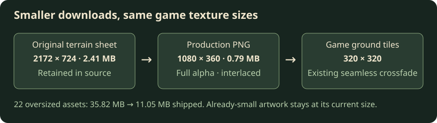

# Build assets and bundle analysis

[Development guide](../development.md).

`pnpm build` first resizes oversized, used PNGs to the bounds declared in
[`asset-render-sizes.ts`](../../packages/client/asset-render-sizes.ts), then compresses PNGs through
[`vite-plugin-image-optimizer`](https://github.com/FatehAK/vite-plugin-image-optimizer)
in the client's Vite config, including copied public assets. Individual client
package builds do the same. PNG palette conversion is disabled to preserve sprite
pixels. Optimized PNGs use Adam7 interlacing so supported image elements can show
the whole image at increasing detail while it downloads. Atlas loaders that wait
for `load` still process only the complete image. Source assets, licenses and
development serving are untouched. The resize pass only writes production copies,
preserves aspect ratio and alpha, uses nearest-neighbor sampling to match existing
atlas packaging, and never enlarges an image. Builds fail if a declared image
cannot be decoded or resized. The optimizer
logs byte savings and keeps original bytes when compression would increase size.
It strips image metadata and logs optimization errors while retaining the original
file. It does not preserve animated or high-bit-depth PNGs; exclude such assets in
the Vite config if introduced. Current sprites are static 8-bit PNGs.
Run `pnpm test:images` for real Vite build checks of the client configuration.

Concept preview of loading order; this is not a gameplay capture or a browser
timing measurement. Images retained by the size fallback keep their source encoding.

Use `pnpm --filter @emberfall/client analyze` for an optional production build
with a `rollup-plugin-visualizer` bundle report. Open the selected package's
`node_modules/.cache/bundle-report.html` to inspect dependencies and estimated
gzip/Brotli sizes. Reports are ignored by Git and stay outside deployed `dist`.
Normal builds do not generate reports. Text compression runs in both build modes;
see [serving and deployment](../operations/deployment.md#deployment-and-cache-consistency).

## Render-sized production copies

Bounds describe existing backing textures, including the 2x detail retained by
actor/scenery packaging, rather than a single viewport's screen pixels. Viewport
size and graphics settings can scale the same game texture further.

| Used artwork                           | Production bound            | Reason                                                                       |
| -------------------------------------- | --------------------------- | ---------------------------------------------------------------------------- |
| Terrain                                | 1080×360                    | Three 360px variants feed the 320px ground tile and its 359px overlap sample |
| Environment                            | 1080×1080                   | Three-by-three 256px scenery frames after trimming transparent margins       |
| Plants                                 | 640×214                     | Five 128px frames, retaining source aspect and uneven column boundaries      |
| Wardrobe                               | 1152×384                    | Four 256px trimmed frames with the original 3:1 sheet aspect                 |
| Animals / bear                         | 512×768 / 576×288           | Four columns of 128px trimmed frames                                         |
| Skeleton, brute, caster / runner       | 512×1024 / 576×1152         | Existing 2x 64px actor grid after trimming                                   |
| Portal                                 | 336×336                     | Enough visible pixels for the 2x 128px cell after trimming                   |
| Effects / pickups / gathered resources | 576×576 / 336×252 / 456×152 | Existing 128px or 64px cells after trimming                                  |
| Buildings / storehouse / lodge         | 873×291 / 288×246 / 254×256 | At least 2x their 128px/96px game width, rounded up for exact source aspect  |
| Talent icon sheets                     | 600×720                     | Uneven cells retain at least 2x the largest 52px picker icon                 |
| Clear-slot icon                        | 104×104                     | 2x the 52px picker tile                                                      |

Raw source sheets retain their original layout. `loadArt` still packages frames
and applies existing colors, gutters and foot anchors. Native building loads
record their source-to-production resolution so village crops, shadow masks,
gallery previews and chimney anchors use the same authored coordinates.

Player atlases, portraits, item/status/slot icons, resource-state sprites,
Innkeeper/workstation sheets, cursors, favicons and talent cast effects are already
at or below the detail needed by their largest current consumer and are not
downscaled. The Warden source also supplies a 112px Codex portrait; its 887px-wide
four-column sheet is already approximately 2x that crop. Unused authoring/reference
sheets remain bundled for provenance, not resized to an invented display size.
New artwork or larger consumers must update the owning bound when necessary;
this is an explicit usage map, not automatic CSS analysis.

Pipeline illustration, not a gameplay capture. With the current 22 bounded assets,
a local production build reduced 35,815,312 source bytes to 11,046,959 shipped
bytes (69%); this is a file-size measurement, not a frame-time claim. All 22 resized
outputs were interlaced. Other images may still be logged as skipped when their
full-size progressive encoding is larger than their original.
