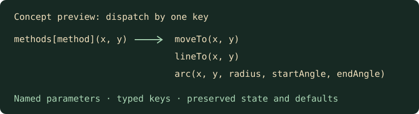

# Code structure

[Back to Development and verification](../development.md).

## Code structure

Keep each module focused on one responsibility. Split implementation, declarative
definitions and domain test groups at their ownership boundaries; keep composition
roots small and their dependencies explicit. Oxlint caps JavaScript and TypeScript
files at **249 nonblank lines**, including comments. Blank lines are excluded so
readable spacing does not compete with the size limit. The reviewed
`packages/client/src/rendering/pixi-context.ts` drawing façade has a **260-line cap**:
it implements one drawing interface while state, textures, pools and lifecycle live
in separate modules. Its exception permits no further growth. Extract meaningful
ownership rather than forwarding wrappers or compressed formatting to meet a cap.
Required braces and explicit arrow-function returns count toward these limits.
Keep those rules enabled when splitting a file; preserve public exports, story
IDs, test entry points and lifecycle ownership across the new modules.
Review stylesheet and configuration size by the same responsibility guideline.

Name functions for their actions and values for their domain meaning. Keep guards
and error paths explicit, and break complex expressions into named steps when
that makes their purpose clearer. Short geometry names such as `x` and `y` are
appropriate when their meaning is clear. Human review still checks readability;
passing automated checks alone does not establish a good module boundary.

Represent repeated content choices with typed objects or maps, checked with
`satisfies` where it preserves useful literals. Let existing rules consume those
definitions, as core's drop tables do. Keep side effects and transactions in their
own owners; a configuration table does not replace validation, save ordering or
error handling. Reuse the documented package dependency directions, enforced by
[`package-boundaries.test.ts`](../../tests/package-boundaries.test.ts).

### Dispatch tables

When one value selects independent operations, use a typed handler table and
call `methods[method](...)`. When branches only select data, use a typed value
map or an indexed array. Give handlers domain parameter names (`x`, `y`,
`radius`, `player`, `message`) and concrete types. For queued commands with
different signatures, use named tuple elements and mapped handler types to
keep each command's parameters checked; see
[`drawing-path.ts`](../../packages/client/src/rendering/drawing-path.ts).
Keep reusable tables outside hot loops and avoid creating unselected UI content.

Preserve validation, receiver binding, side effects, execution order and the
existing fallback. For open string keys, check `Object.hasOwn` before indexing
an object, or use `Map.get`; inherited keys must not become handlers. Use a
complete `Record` or mapped type for a closed union. Keep guards, ranges,
overlapping predicates and ordered state transitions as explicit conditions.
A two-way decision can remain an `if` or ternary when that is clearer.

This source-code example illustrates the convention, not verified gameplay.
The [lint policy](quality.md#dispatch-lint) describes the automated subset.
