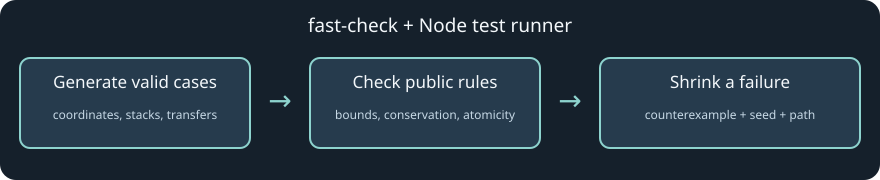

# Commands and CI

[Back to Development and verification](../development.md).

## Commands

The [Verify workflow](../../.github/workflows/verify.yml) always runs formatting,
lint, typechecking, core and root Node suites, and builds on every pull request.
Pull requests also run affected shared UI browser checks selected by
[browser selection](../../scripts/ci-browser-tests.ts). Desktop game checks are
disabled on pull requests and skipped by default on manual runs. Desktop
allowlists exclude existing mixed phone/touch scenarios.

For a release candidate, run **Actions → Verify → Run workflow** on
`main` (CLI: `gh workflow run verify.yml --ref main`). To include the complete
14-file desktop game baseline, enable **Run desktop game checks** (CLI: add
`-f desktop_game_checks=true`). Manual runs always execute shared UI checks.
A successful manual run on
current `main` triggers Pages deployment of that exact SHA. Intermediate merges
do not repeat the PR run. A stale release is rejected before building and
before deployment. See [operations](../operations/github-pages.md#github-pages-client-with-a-server-on-your-machine).
Browser tests use disposable certificates/databases; failures retain CI artifacts.
Git checks text out with LF on every platform through `.gitattributes`.

```sh
pnpm install --frozen-lockfile
pnpm fmt:check
pnpm lint
pnpm typecheck
pnpm test
pnpm build
```

The formatter is Oxfmt; `pnpm fmt` writes formatting. `pnpm test` uses Node's test runner for `packages/server/src/*.test.ts`, and `tests/*.test.ts`, including shared simulation, client helpers and asset checks. Build includes client, server and the static UI Storybook through Turborepo. The [GitHub Pages workflow](../../.github/workflows/deploy-pages.yml) builds and deploys the fully verified client after a successful manual Verify run on current `main`; local verification commands remain separate from deployment.

Node suites are grouped by behavior, such as cast admission, companion lifecycle,
NPC reply scheduling and persistence. Related suites share their domain's
`*.fixture.ts` factories; per-file hooks stay in the test modules. Fixtures are
not test entry points. Keep server test files directly in `packages/server/src`
and core registry tests in `packages/core/src/content/tests` so the existing
runner globs discover them. Cross-package presentation fixtures live in `tests`
so production package dependency rules still apply. When splitting suites, preserve case bodies,
parameterized cases and hook scope, then verify discovery and the complete suite.

### Property-based tests

Use [fast-check](https://fast-check.dev/docs/introduction/) with the existing Node
runner for invariants across generated inputs. It is a root development dependency;
no runtime package or separate CI job is needed. `pnpm test` discovers the pilot:

- [Geometry properties](../../tests/geometry-properties.test.ts): wrapping bounds,
  whole-world translations, shortest displacement and half-world ties.
- [Inventory properties](../../tests/inventory-properties.test.ts): resource and
  consumable transfers conserve quantity and unique identities, respect slot/stack
  limits, and leave both inventories unchanged when a destination is full.

Run just these suites with
`node --test tests/geometry-properties.test.ts tests/inventory-properties.test.ts`.
Each property runs 200 generated cases: enough for a small pilot without slowing
the normal suite substantially. Inputs use bounded integers so geometry arithmetic
is exact, and inventory fixtures stay within valid game limits. Existing worked
examples remain the independent checks for specific tuning values and regressions.

On failure, fast-check shrinks the input and prints the counterexample, `seed` and
`path`. Temporarily add those values to that failing `fc.assert` options object
alongside `numRuns`, rerun the focused command, and retain the minimized case as an
explicit regression test when fixing a bug. Remove the temporary replay options
afterward so normal runs continue exploring new inputs. See the official
[runner documentation](https://fast-check.dev/docs/core-blocks/runners/).



This diagram describes the test workflow; it is not a gameplay capture.

### Browser suite organization

Browser suites retain their `*.spec.ts` entry points and import focused
`*.cases.ts` groups. These groups are not separately discovered, so existing
commands, CI selectors and per-entry hooks continue to apply. Shared setup lives
in `*.fixture.ts` modules. Screen composition stories retain their named exports
in `Screens.stories.tsx`, with private render components in `stories/screens`.
The renderer pixel fixture keeps canvas ownership and comparison results in its
entry module and delegates surface, lighting, damage and loot probes to helpers.
