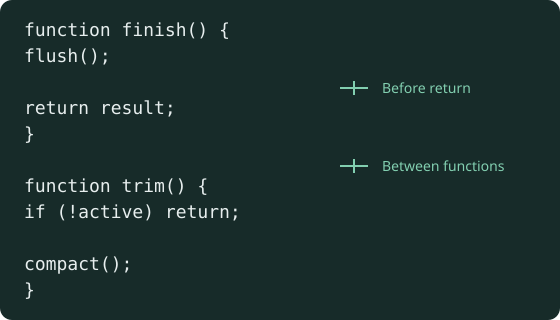

# Lint and TypeScript policy

[Back to Development and verification](../development.md).

## Lint policy

The root `.oxlintrc.json` is shared by local commands, editors and CI runners.
It enables correctness rules from TypeScript, Oxc, Unicorn, React and JSX
accessibility, plus selected suspicious checks (`no-debugger`, `no-eval` and
`no-implied-eval`). Review new suspicious rules individually before enforcing
them; pedantic, restriction and nursery categories are not enabled wholesale.
Require curly braces even when JavaScript permits omitting them:

- `eslint/curly: [error, all]` covers `if`, `else`, `for`, `for...in`,
  `for...of`, `while` and `do...while` bodies, including single statements.
  Conventional `else if` chains remain supported.
- `eslint/arrow-body-style: [error, always]` requires arrow-function block
  bodies; return values explicitly, including object literals and JSX.
- `unicorn/switch-case-braces: [error, always]` scopes nonempty `case` and
  `default` bodies. Empty labels may remain grouped for shared handling.

Function, class, `try`/`catch`/`finally` and `switch` bodies already require
braces in JavaScript syntax. These rules apply across source, scripts and tests;
run `pnpm exec oxlint . --fix` to migrate supported cases, then `pnpm fmt`.
Formatting belongs to Oxfmt: single quotes, JSX single quotes, consistent
indentation and wrapping. Oxlint loads `@stylistic/eslint-plugin` for the
blank-line rules below; Oxfmt preserves their spacing. Run `pnpm fmt:check`
before submitting changes.

### Blank lines

Use one blank line to separate functions and logical steps:

- Separate function declarations from adjacent statements, including other functions.
- Separate class methods (including constructors and accessors) from adjacent
  members; consecutive data fields can stay together.
- Put a blank line before `return` and `throw` when another statement precedes
  them in the same block or switch case. A sole return or throw, including a
  compact guard, needs no extra padding.
- Put a blank line before `for` (including `for...in`, `for...of` and
  `for await...of`), `switch` and `if` when another statement precedes them in
  the same block or switch case. Keep `else if` chains together; add no padding
  at the start of a block.
- Put a blank line after control-flow blocks before the next statement.
  Keep related assignments and declarations together; use judgement to separate
  other logical steps, including arrow-function bindings and object methods.

These rules are errors in `pnpm lint`, including editor and CI checks. Apply
spacing fixes with `pnpm exec oxlint . --fix`, then run `pnpm fmt`. Avoid blank
lines at the start/end of a block and repeated empty lines; Oxfmt normalizes them.

```ts
function finish() {
  flush();

  return result;
}

function trim() {
  prepare();

  if (!active) {
    return;
  }

  compact();
}
```



The examples illustrate source layout; they are not gameplay captures.

### Other strict checks

#### Dispatch lint

`emberfall/prefer-dispatch` uses the local
[`dispatch-lint.mjs`](../../scripts/dispatch-lint.mjs) plugin in the shared Oxlint
configuration. It rejects runs of three or more `===` branches comparing the
same identifier or noncomputed property path to string or number literals in
an `if`/`else if` or ternary chain, including reversed comparisons. It reports
once per run and has no automatic fix: preserving narrowing, defaults and
side effects requires review. The rule runs in editors, `pnpm lint` and CI.

The broader [dispatch-table convention](code-structure.md#dispatch-tables)
also covers suitable switches and separate early-return branches. Those,
compound guards, computed keys, optional chains and range checks remain manual
review decisions. Tests exercise both rejected cascades and accepted tables,
guards, ranges and calls in
[`dispatch-lint.test.ts`](../../tests/dispatch-lint.test.ts).

#### Type and runtime checks

Selected rules additionally require immutable bindings when possible, block-scoped
declarations, consolidated imports, explicit type imports, exhaustive union
switches and throwable errors. Strict equality permits the conventional
`value == null` check for both null and undefined. Separate type imports and inline
`type` specifiers are supported, as are colocated `import()` type expressions for
lazy module contracts. Use top-level `import type` when every imported binding is
type-only, so verbatim module syntax does not introduce runtime side effects.
Redundant assertions, duplicate/redundant union members,
unnecessary type arguments and unsafe assertions after optional chaining fail lint.

`oxlint-tsgolint` provides type-aware checks, including floating and misused
promises. Keep `pnpm typecheck` separately: experimental Oxlint type checking
is not enabled. TypeScript includes are scoped to workspace source, package
configuration and tests, excluding dependencies and generated build output.
The root includes the CI TypeScript scripts as well as packages and tests. It
requires explicit overrides, complete return paths, unused-code cleanup, no switch
fallthrough, no unreachable code or unused labels, checked side-effect imports,
consistent path casing, explicit type-only module syntax and erasable TypeScript.
Package configs inherit these compiler options. Prefix a required callback's
unused positional parameter with `_`; remove unused parameters from private
functions and their callers instead.

`strict` remains enabled. `noUncheckedIndexedAccess` and
`exactOptionalPropertyTypes` remain separate migrations: initial probes produced
over a thousand indexed-access diagnostics and 276 optional-property errors.
Adopting them requires validating collection lookups and distinguishing omitted
fields from explicit undefined throughout saves, protocols and rendering. Blanket
non-null assertions or widened optional types would hide that work.

The root remains a source-checking project; it is not a project-reference
solution, so replacing its includes with `files: []` would skip source checks.

Warnings and unused suppression comments fail `pnpm lint`. Use file overrides
for narrow exceptions: Node test registration promises are owned by the test
runner, while other promises in tests must still be handled. React uses the
automatic JSX runtime, MUI dialogs manage autofocus, and semantic ARIA roles
remain supported for composed controls and canvas diagnostics. Intentional
exceptions in code must name the rule and explain why it does not apply.

Use root overrides for package-specific policy before adding nested configs.
Run `pnpm lint` from the root without `--config`, which disables nested config
discovery. The Oxc editor extension reads `options.typeAware` from the root
config; it needs the installed workspace dependencies. When adding a lint step
to CI, run the same `pnpm lint` command after `pnpm install --frozen-lockfile`.

To investigate lint cost, run `pnpm exec oxlint . --debug timings`; measure
the full type-aware run before changing TypeScript project boundaries or
splitting checks by package.
