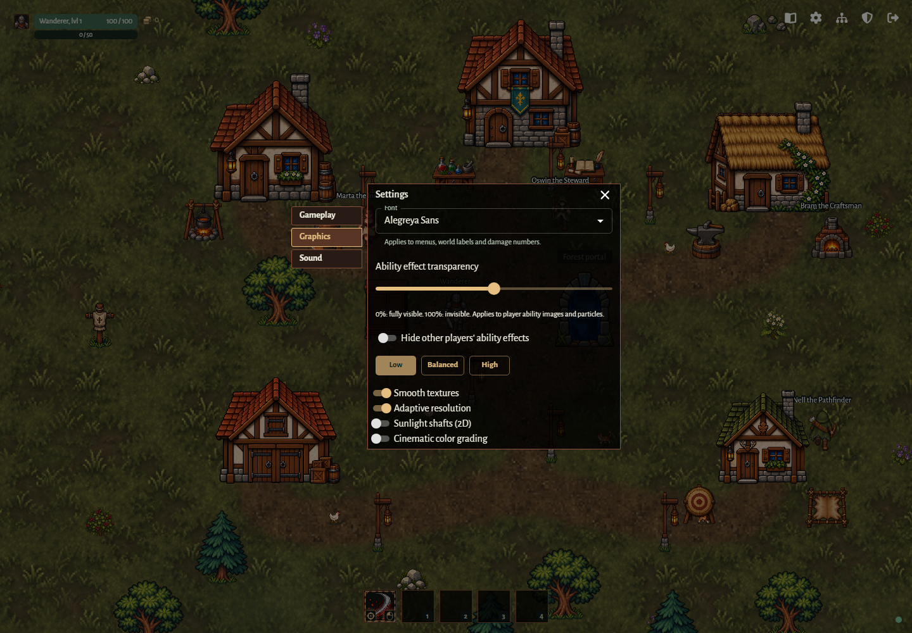
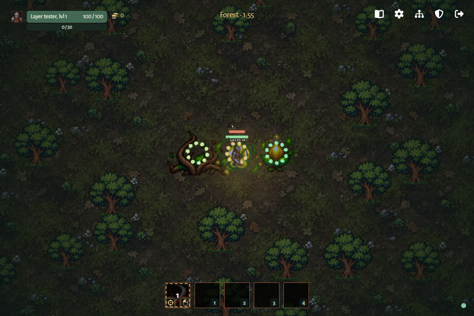

# Combat readability

[Back to Graphics and visual feedback](../graphics.md).

## GRAPHICS-04 — Combat readability

Settings → Graphics includes a persistent **Ability effect transparency** slider
from 0% (fully visible, default) to 100% (invisible), and **Hide other players'
ability effects**, enabled by default for new and existing browsers. These apply
immediately to player projectile images, explosions, talent images/particles and
Warrior swings in training and forest. Quality presets preserve both choices.
Enemy attacks, danger warnings, actors, status icons, damage numbers, loot and
blood retain their existing presentation.

Verified desktop settings capture from an isolated browser session:

Ability effects (player projectiles, explosions, talent casts and Warrior swings)
draw directly above the background tiles in training and forest, below scenery,
actors, loot, health bars and status icons. Enemy projectiles share this low pass;
red ground warnings retain their existing pass and remain enabled at every preset.

Verified forest capture from the isolated browser scenario: Druid talent art
stays beneath combatants and their overhead labels (bundled artwork; see
[credits](../../assets.md)).

All overhead health bars (players, companions, bosses, regular and elite enemies,
training dummies and partially gathered trees) match the gathering bar's
5-world-unit fill and 1-unit dark border on every side (7 units total height).
Their existing widths, health colors and name positions remain unchanged. Bars
grow upward, with speech bubbles and debuff rows kept clear of the frame.
HUD and party health meters retain their existing styling.

Settings → Gameplay includes a saved **Hide health bars in town** toggle, enabled
by default for new and existing players. It hides overhead player, companion,
training dummy and resource-tree health bars in the village, while preserving
names, status effects, party HUD meters and gathering progress. Disabling it
restores town bars immediately. Forest health bars remain visible either way.

In the new client, all player projectiles (arrows, fireballs and Druid roots) have
a thin, one-world-unit light-green silhouette outline in training and forest,
at every graphics preset. Their class art, size, animation and flight remain intact.

Active debuffs appear as 12-unit framed icons with a 2-unit gap, aligned to the left edge above the health/name area, with only outlined stack counts in their lower-right corners. Roots use the same row and outlined stack style. Silence uses the same row without a stack count; it is a non-stacking status. The shared renderer accepts timed ailments and indefinite statuses; Silence uses a bronze-framed crossed speech icon suitable for future player debuffs. Expired effects disappear and an empty row takes no space. Weapons appear on living characters and animate with their existing attacks; outside combat, upward-facing characters carry their class weapon across their back, including when they stop after walking up. Other non-combat directions keep weapons hidden. Wardrobe choices show weapon and ability icons. Combat rules and network state are unchanged. Existing browser coverage checks all class assets, icon placement, expiry and stacks, plus back-weapon visibility for all four classes and movement directions.

Portal voting lives inside the draggable portal window, with a compact control to reopen it. Prompts project each source's world coordinates through the camera, rather than sitting at the screen edge. Village and return portals have an animated blue pixel-ripple interior, a pale blue rim, and outward-drifting square motes. Bloom adds a soft blue glow; the surface remains visible with bloom disabled. Portal bodies and their fading blue motes draw before characters. At scene completion each player's nearby portal stays fixed where it spawned.

Damaged enemies (including elites, bosses, and training dummies), companions, and the local player briefly show a red sprite outline and white tint, fading over 220 ms. Killing blows flash during the enemy death animation. Other players do not receive this sprite effect. Each new hit restarts the flash, including damage over time. Local damage also flashes the screen red. A persistent Vignette toggle controls edge darkening in both village and forest. Fog and flying ambient particles use world coordinates and seamless world-sized repetition; camera movement only changes which portion is visible.

Diagonal facing retains its current valid axis near a 45-degree heading to prevent sprite flicker. Player sword reach is 88 units. Neither client draws a green attack-range circle or forward semicircle on the ground at any graphics preset. The sword visual and server hit distance share the same range constant. Damage remains 5 per swing.

Blood puddles have their own persistent gameplay toggle. Damage numbers and hit effects present server events; they cannot award damage or XP.

Dropped equipment and consumables have a short, pale-gold vertical beam behind
their icons, fading upward from the ground. The marker stays visible at every
graphics preset until collection or expiry and follows wrapped pickup positions.

In the new runtime, floating damage numbers combine hits from the same player to
the same target with the same damage type within 10 ms of the first hit (inclusive),
using server event timestamps. Each total keeps the first hit's position and
lifetime, sums exact amounts before rounding, and uses critical styling if any hit
was critical. Later hits start a new total; hits without player attribution remain
separate. This applies in training and forest and does not alter damage or DPS.

Floating battle text pops on impact, settles, then drifts upward and outward in
stable lanes so successive hits do not all cover one another. Normal numbers keep
their damage-type color; incoming damage stays red. Critical hits use larger
white numbers with a red outline. Every number has a dark readability outline,
holds full opacity initially, and fades completely by 750 ms, within the server's
800 ms event retention. The existing Floating damage numbers toggle controls the
effect in both areas, independently of graphics preset.
