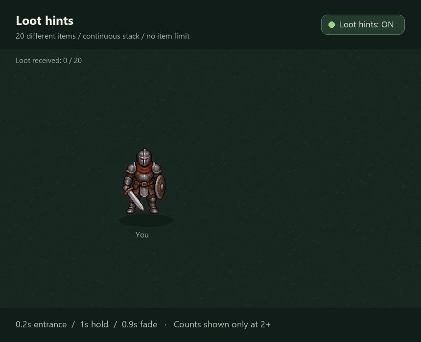
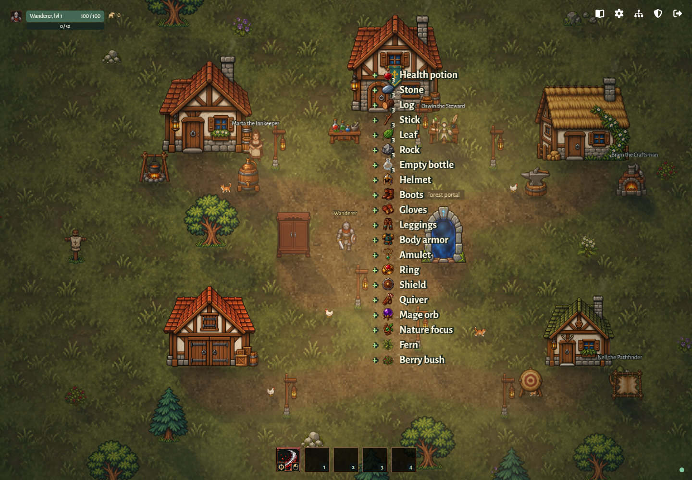

# Loot hints

[Graphics specification](../graphics.md). These are implemented local feedback rules.

Loot hints default to enabled under Settings > Gameplay and persist locally.
Confirmed backpack increases show `+ [item icon] item name` beside the local
player. Initial inventory is silent. Icon counts appear only for quantities >=2.
Compact 14-unit text and 18-unit icons use 20-unit rows in a centered, uncapped
stack. Hints enter from below over 200 ms, hold for 1 second, then rise and fade
for 900 ms. Disabling clears hints without replaying them when enabled again.

Approved loot-hint animation concept (illustrative quantities; existing game artwork):

Implementation: [renderer](../../../packages/client/src/loot-hint-rendering.ts),
[receipt tracking](../../../packages/client/src/loot-hints.ts). Verification:
[animation and quantity tests](../../../tests/loot-hints.test.ts),
[browser scenarios](../../../tests/loot-hints.spec.ts).

Verified village gameplay capture from the isolated browser scenario:

The concept and gameplay images reuse bundled artwork; see [asset credits](../../assets.md).
