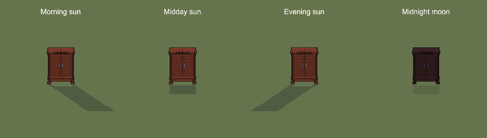
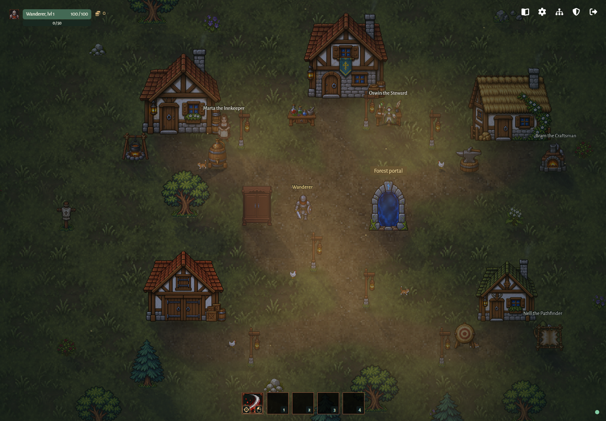
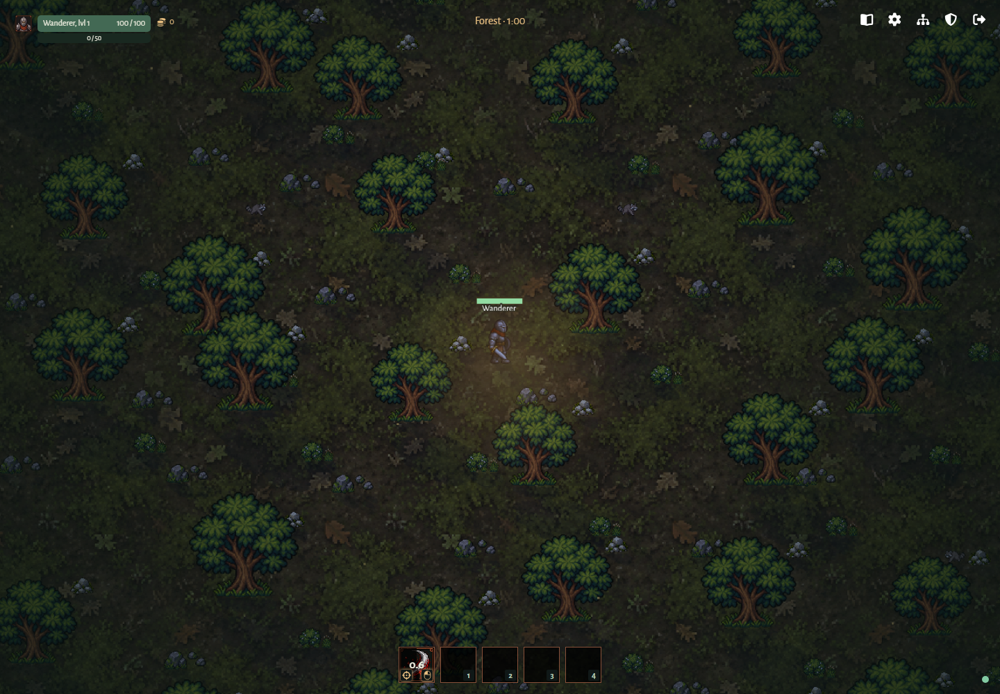

# Village lighting, scenery and atmosphere

[Back to Graphics and visual feedback](../graphics.md).

## GRAPHICS-02 — Village lighting

A moving distant sun, replaced by a weaker moon at night, produces parallel projected silhouette shadows throughout the village. Tall path lamps use a bronze post and orange lantern from [Karsiori's FREE Pixel Art Lantern Pack](https://karsiori.itch.io/free-pixel-art-lantern-pack), under CC0. The unmodified PNGs are combined and scaled at runtime using the lantern's original 38-frame fire animation with rising orange, red and gold portal-style embers (Ambient particles controls embers; Bloom controls their glow); credits and the original readme are in `public/assets/lanterns`. They retain the torch positions and 20x60 world dimensions and cast warm light with weak, radius-limited occlusion (145 world units); every player emits warm light with a moving 110-unit radius, without a visible belt lantern. Local shadows project away from their emitter, weaken with distance and disappear outside its radius. Trees, buildings, grass, torch posts and character sprites participate. A player light does not shadow its own character. Sunlight is directional 2D projection, not a 3D renderer.

Celestial shadows update with the shared clock; static torch occlusion is cached, while dynamic character blockers and player lights update as players move. Light scratch canvases are reused. Existing Soft shadows, Dynamic lighting and Bloom settings control these passes. Disabling effects never changes collision geometry. The sun and moon stay offscreen; their moving light sources never obscure the playable map.

## GRAPHICS-03 — Scenery and atmosphere

Village and forest share a continuous, server-synchronized 60-real-minute day:
6 minutes of dawn, 30 of daylight, 6 of dusk and 18 of night. World sprites
blend from cool readable blue nights through warm dawn/dusk into natural daylight
at every graphics preset. Text and geometry-based combat warnings retain their
colors. Existing dynamic lights strengthen at night and sunlight shafts fade out.
Rejoining or changing areas does not restart time. Sunlight travels east to west through dawn, daylight and dusk; moonlight takes
over for the night and follows the same path. Shadows rotate and shorten near
the highest point, lengthen toward the horizons, and fade out at each handoff.
Moon shadows are weaker. Buildings, wardrobe, foliage and actors share the same
direction in village and forest. Soft shadows controls both celestial passes;
local lamp occlusion keeps its emitter-relative direction. The cycle changes
presentation only and never affects combat or saves.

Verified desktop Pixi rendering at fixed clock phases, using the shipped wardrobe
sprite: morning, midday, evening and the weaker midnight moon. This is an isolated
renderer capture, not a gameplay scene or a concept preview.

Verified gameplay captures from the isolated browser session (current server
phase, Balanced graphics). These are implemented village and forest views,
not the earlier generated concept. Both reuse bundled art; see [credits](../../assets.md).

Fog is animated, seamlessly tiled and layered; it is disabled by default in every preset and can be enabled individually. Saved individual fog preferences remain in effect on reload. Fog and flying particles use world coordinates with seamless repetition. Dense grass, paths and scenery share depth ordering with actors. The renderer draws baked fog sources with native Pixi sprites.

Scenery in front of the local player has a fully transparent hole matching the player's current animated silhouette, expanded by 10 game pixels in every direction. The hole reveals the ground and previously drawn layers; the rest of each sprite stays fully opaque. The mask follows the reconciled position, facing and breathing pose, including across wrapped map edges, and disappears when the player moves clear or in front. This applies to village trees, buildings, wardrobe and torch posts, and forest trees. Players can walk through all scenery; shadows remain unchanged. In the new runtime, training dummies, enemies, other players, companions and decorative animals share this foot-position depth ordering and use the same silhouette cutout when covering the local player. Player ground identification rings are not drawn; sprite sizes stay unchanged.

Settings → Graphics includes **Waving grass and trees**, independent of grass density. Enabled by default and in Balanced/High, disabled in Low; the choice persists across reloads. Both areas use gentle, staggered foliage sway with fixed roots. Disabling it immediately restores static sprites. Sprite drawing applies a time-based horizontal shear without changing collisions, sorting, silhouette cutouts, or cached shadows; each renderer implements the same transform. Browser checks cover movement in both areas, fixed roots, live toggling, presets, and persistence.

Decorative cats and chickens wander in the village; raccoons appear in the forest. They are deterministic client visuals, participate in shadow passes and do not affect combat, collision, loot or party scaling.
