# Controls, interface and audio

Status: implemented baseline. Goal: Readable feedback and usable controls while the server owns the game rules. See [technical design](../design/presentation.md).

## UI-01 — HUD and windows

The optional DPS meter and FPS/latency monitor float independently of the party
frames. Enabling or disabling them never moves party frames. With no saved drag
offset, each widget starts at the viewport center; dragging retains its local
offset across toggles and sessions, clamped to the viewport on resize.

While in a world, a fixed bottom-center action bar shows the equipped weapon's
base ability with the same ability icon as Wardrobe, followed by four empty ability
slots. Unequipping the weapon hides only the base-ability slot. Every slot retains
the same translucent black
background and brown border as game windows. Abilities show a clockwise radial
cooldown sweep and remaining seconds, clearing when ready. The display follows
confirmed attacks and equipment cooldown stats in village training and forest;
existing auto-attack and held-LMB controls still cast the ability. The bar stays
centered on narrow screens, with chat above it when space is limited.
Each slot shows its hotkey at bottom right: a left-mouse-button icon for the base
ability and 1–4 for the four empty slots. A target icon sits at the base slot's
bottom left. The mouse and target icons independently glow and pulse while
auto-attack and auto-target are enabled, reflecting saved settings and F/G toggles.
Reduced motion keeps a steady glow. Indicators remain visible over cooldowns;
empty slots remain unassigned and do not cast abilities. LMB opens an icon picker
with an equally sized generated red clear tile. RMB toggles auto-cast. Enabled
abilities show marching dashed borders (steady with reduced motion). Auto-attack
is the master switch, preserving individual talent choices while off. Hover, keyboard focus or
touch on an equipped ability opens a custom tooltip with its name, equipment
cooldown and description, reusing the Talents description for learned abilities
and the Wardrobe description for the base attack. Casting and automation instructions
are omitted from tooltips; slot indicators still show their state. Tooltips share game windows' translucent
black surface, brown border, square corners and theme typography.

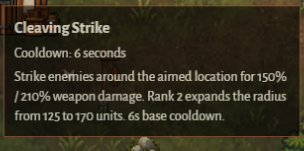

All game windows use compact, lighter title bars, wardrobe-brown borders and thin scrollbars. Every tabbed window places its tabs vertically outside its left border, with left-rounded brown frames and a filled gold-accented selected state. The rail moves with the window, stays within the viewport and scrolls independently of the content. Up/Down, Home and End navigate tabs. Backpack slots use matching brown borders and dark wood backgrounds, with 20 slots shown by default.
The trader has Buy and Buyback tabs, with 20 Buyback slots. A small Sell all icon
button sits at the top-right of the player's backpack, opposite the gold balance.

The arena fills the viewport with an aspect-preserving camera centered on the local player. Codex, settings and exit are compact controls; the bottom-right colored circle reports connection status. F1 opens Codex and Escape opens Settings when no window or text input is active, including before joining a world. Each window's opening hotkey also closes that window; Escape closes the current window first. Holding a hotkey does not repeatedly toggle its window, and F1 suppresses browser help even while a window is open. The top-right HUD orders Inventory, Talents, Tactics, Codex, optional Portal vote, Settings and Leave world. Inventory uses a bag icon and Talents uses magic sparkles. I, N, T, F1 and Esc appear as small badges below the matching icons and in tooltips; actions without hotkeys omit badges. Leaving remains last, after Settings. HUD tooltips show each action's available hotkey; leaving uses the explicit exit control. Codex/settings use draggable modal dialogs and suppress movement while open. Settings can toggle ambient particles. Nicknames belong to Steam accounts; see CHAR-05.

Party cards show server-owned `Nickname, lvl N` inside the HP bar, adding `P` and the paragon level when positive. A thinner blue XP bar directly below health shows current/required XP using the shared progression formula. The class portrait matches the health bar height; a crown marks the party leader in its top-right corner and a dimension icon marks players in another area in its top-left corner. Icons retain accessible labels and away players stay dimmed. Thin health bars also appear beneath player names.

When a player has a battle companion, their party card shows a smaller portrait and HP bar directly below the player's row. It displays the companion's name and confirmed current/maximum HP, including zero HP while defeated, and disappears when the player no longer has a companion.

Party health bars use 60% of their previous width, including the companion row. In the new runtime, each player's confirmed coin balance appears immediately after their HP bar with a coin icon. Amounts use compact lowercase suffixes (13, 1k, 3m), at most one decimal, and an accessible label with the full amount.

Wardrobe shows all four classes in one compact row. Each card has its matching character portrait above separate starting-weapon and base-spell squares, then level, XP, maximum HP, Power and a selection button. Power uses calculated class equipment stats. Weapon and spell details open on hover, keyboard focus or touch and explain the current attacks, range, cooldown and effects. There is no introductory or departure helper text. Class selection retains server validation, per-class progress and countdown restrictions; inspecting details remains available for selected or unavailable classes.

During an active boss fight, forest players see a fixed top-center boss HUD with the boss name (The Hollow Warden), orange health bar and current/max HP, even when the boss is offscreen. It replaces the boss objective label and disappears on defeat or returning to the lobby; the scene-complete message then appears.

Codex uses the shared forest theme with chapter tabs for controls, worlds and party, combat, the boss, character persistence, classes, and credits. Every chapter uses short sections, readable lists where appropriate, and relevant game artwork with accessible descriptions. Illustrations fit narrow screens without horizontal scrolling. Tabs support arrow keys, Home, and End; the book remains draggable and closable and keeps its size and position when switching chapters.

### Tactics

Tactics (T) appears immediately after Talents in the in-world HUD. Its draggable
window uses the same three external left-side tabs as Codex: Offensive, Defensive
and Positioning. T toggles it, Escape closes it, held keys do not repeat, and text
entry or another modal prevents accidental opening. The world continues while it
is open; gameplay input and automatic talent requests follow existing modal rules.

Settings apply immediately after server confirmation and save per character class.
Older saves without tactics retain nearest-target attacks, lowest-health healing,
and Balanced companion behavior. Priority rows move with labeled up/down buttons;
the first rule wins and later rules break ties, retaining entity order on full ties.
Only living eligible targets in wrapped range participate. Manual cursor aiming,
self-centered effects and fixed-recipient heals keep their dedicated behavior.

Offensive orders Nearest enemy, Lowest health %, and Elite / boss first (bosses
before elites before ordinary enemies). Keep current target retains a valid target
within the current ability's range; it defaults off to preserve existing behavior.

Defensive orders Lowest health %, Players before companions, and Self before
allies. Include companions defaults on. Auto-heal below offers Any missing health,
90%, 75%, or 50% HP. The threshold gates automatic targeted-heal casts and automatic
Healing Grove casts; it does not block manual casts or later healing pulses.
Party, area, run, connection and range checks always precede preferences.

Positioning configures the current class's companion. Balanced preserves nearby
hunting; Aggressive pursues across the preferred owner radius; Protect owner
restricts engagements to 100 units around the owner; Passive follows without
attacking. Close / Medium / Far set the preferred combat radius to 100 / 200 / 300
units. Balanced engagements cap at the existing 200 units. All stances retain the
500-unit teleport tether, return behavior, tree avoidance and resurrection rules.
Target mode follows offensive priorities, assists the owner's current valid target
(falling back to priorities), or chooses enemies nearest the owner. Avoid telegraphs
and projectiles defaults on and controls the existing hazard avoidance. Companion
controls are disabled for classes without a companion, with an explanation.

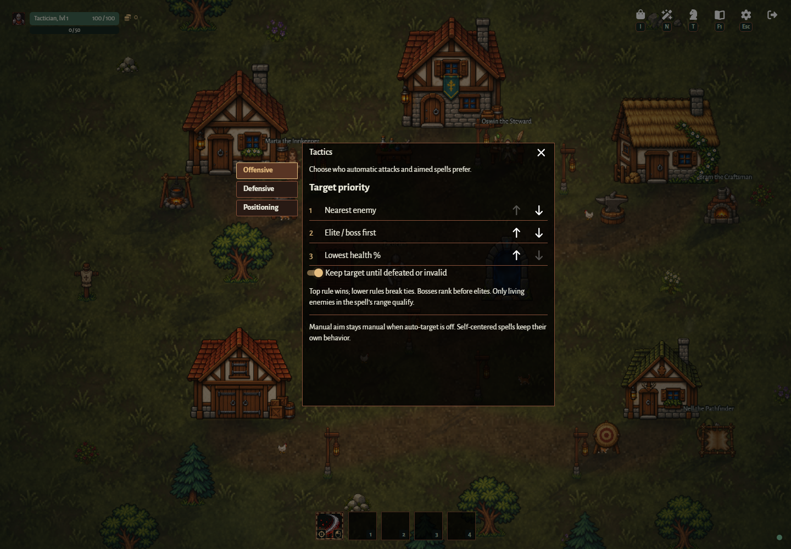

## UI-02 — Combat controls

Holding either Alt key suppresses browser Alt behavior. After holding Alt for more
than 0.5 seconds, it shows thin green
outlines on all visible interactive objects in village and forest, regardless of
interaction range. This includes functional buildings, Marta, cats, portals and
non-depleted gathering resources, and players eligible for Invite, Join or Accept
party actions. Alt-modified text entry remains available for keyboard layouts that
use AltGr. Releasing Alt restores normal yellow hover
outlines. Losing focus or hiding the tab clears the held state; dialogs and text
entry suppress the highlights. Alt does not change interaction range or actions.

When an interaction is available, a compact prompt directly below the local
player's name shows a circular E badge and the interaction's short name (for
example, Wardrobe, Gather tree or Return to village). It follows the same target
and confirmed range as the E action in village and forest, including wrapped
seams. It disappears when no action is available, the player dies, or a modal or
text entry blocks gameplay input. Other players do not display this prompt.
Speech bubbles draw above the prompt wherever they overlap.
During gathering the player prompt is replaced by the thin yellow timed-activity
bar above the resource, with a green zone and white indicator, without text above
or below it (see [VILLAGE-07](scenes-and-village.md#village-07--gathering)).
Settings → Gameplay includes **Hide interact hint during combat**, enabled by
default, including for existing saved preferences. It hides only gathering prompts
in active forest scenes and while inside a village training zone with active
training. Other prompts and E/click gathering remain available. Disabling it shows
gathering prompts during combat; changes apply immediately and persist locally.
The prompt uses a dark rounded capsule with a thin bronze outline. Its left end
and the raised E button are concentric, with equal left, top and bottom inset.
The button has a filled shaded face, an evenly thick gold rim and a separate drop
shadow. Highlights provide depth without changing the circular rim's thickness.
The badge is visually separate from the message so a controller glyph can replace
it later; controller support is outside this change.

The client uses an original WoW-inspired ivory/bronze cursor set with ember accents:
a pointing armored glove for the default cursor, a brighter glove for actionable UI hover,
text entry, open/closed drag hands and a barred disabled state. The glove's
fingertip is the click hotspot. In
active forest combat or village training with a weapon equipped, hovering a living
enemy shows a sword; disabling auto-target shows a crosshair instead. Holding LMB
shows the active attack cursor. Death shows the barred cursor. Preview, inactive
combat, open dialogs and focus loss restore the default cursor. These indicators
do not select enemies, change targeting or make world objects clickable.
Settings → Gameplay includes **Custom cursor** (enabled by default) and **Cursor size**:
Small (32 px), Medium (48 px, default) and Large (64 px). Both apply immediately and
persist locally. Disabling custom cursors restores native system cursors for all
states, including combat and portaled controls; the size choice is retained while disabled.

Settings → Gameplay includes saved Auto-attack (F) and Auto-target (G) toggles, both enabled by default. Hotkeys ignore repeated presses, text entry, and open dialogs. With auto-attack disabled, holding LMB casts the class default spell once per one-second base cooldown. Releasing, opening a dialog, hiding the tab, or losing focus stops requesting casts; an already-started swing finishes without resetting its cooldown. Training-area restrictions still apply.

With auto-target disabled, melee aim follows the cursor and ranged spells fly straight around the cursor direction for up to 1000 units, even without an enemy. With auto-target enabled, ranged spells aim around the nearest living enemy in default range. Attack range is not drawn as a ground circle, including when the cursor is beyond spell range. Cursor projection follows the village and wrapped forest cameras. Validated combat input is separate from movement; the server owns cooldowns and expires held-LMB input after 250 ms without a heartbeat. Local presentation shares aim, spread and projectile motion with authoritative combat.

## UI-03 — Network and performance feedback

Gameplay settings can independently show FPS, server latency and the DPS meter. The DPS meter, FPS graph and latency graph are disabled by default; their independent toggles apply immediately and persist across reloads. Existing saved visibility choices are preserved. Latency is a measured WebSocket ping/pong round trip in milliseconds, sampled every two seconds with a monotonic client clock. The toggle persists; a missing or disconnected measurement shows a dash.

The network graph plots ping, input acknowledgement delay, and local snapshot age as separate colored lines on the same millisecond axis. Input acknowledgement delay is the latest consumed command's send-to-snapshot delay, or the oldest outstanding command's age if greater. Local snapshot age includes time since receipt and interpolation backlog, but excludes network transit; it uses the monotonic client clock and differences between server timestamps. A low ping does not imply fresh movement acknowledgements or snapshots. Missing samples leave gaps in each line.

The floating performance panel is 224 pixels wide with 8-pixel side padding. A compact top row shows current FPS, ping and the shared network axis range; a shallow graph below retains the 30-second history sampled twice per second. When network diagnostics are available, a single bottom row identifies input acknowledgement delay, local snapshot age and ping by color. The complete panel stays under 100 pixels tall at the default UI font. Each trace retains its own saved visibility toggle; disabling both hides the panel.

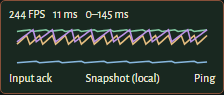

The independently positioned DPS meter stays visible when the graph is hidden. It displays a compact Recount-style Damage done list: one row per current party member (only yourself when solo), ordered by total damage descending. Each row starts with a small class portrait followed by a padded rank and character name, total damage, rolling five-second DPS and percentage of party damage. Ability breakdown rows start with their existing spell, talent, ailment or companion artwork. Column headings and the total footer are omitted. Class-colored row backgrounds and bars show that percentage of total damage, with zero-width bars when no damage has been dealt. Warrior uses tan, Ranger green, Mage blue and Druid orange.

Left-clicking a character opens their damage-dealing abilities, ordered by total damage, with damage, rolling DPS and percentage of that character's damage. Weapon attacks, named talent damage, ailments and Bear damage are attributed by the server through the shared hit path; overkill and hits on dead enemies are excluded. Right-click anywhere inside the meter returns to characters and suppresses the browser context menu. An accessible Back button provides the same action; character rows support keyboard activation. Drag the header to reposition it without interfering with row clicks.

Totals cover the current connected character session, including training and forest, and reset on class change or a fresh character session. They are temporary, not saved progression. DPS retains the rolling five-second window divided by five and returns to zero after five seconds without damage. Leaving a party removes former members from the list; an unavailable selected character returns the display to the current party.

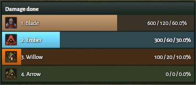

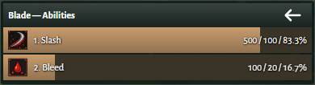

The Bear ability icon shows one idle frame cropped from its companion sprite sheet.

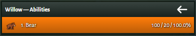

## UI-04 — Settings and music

New runtime: Settings → Account displays the saved game nickname and
opens the same nickname dialog used after first Steam login. Account data is saved
on the server, independently of local presentation preferences. See
[CHAR-05](characters.md#char-05--steam-accounts-and-nickname) and the
[account design](../design/steam-accounts.md). The remaining settings groups are described below.

Settings groups are Gameplay, Graphics and Sound. Preferences persist locally; malformed or unavailable storage falls back to defaults. Gameplay includes auto-attack, auto-target, auto-loot items, blood puddles, damage numbers and performance visibility. Audio has independent music/effects enable switches and volumes; defaults are 0.22 music and 0.35 effects.

Auto-loot items is enabled by default. Disabling it stops attracting and collecting item drops for that player; nearby players can still collect them. XP and gold pickup stay automatic. The preference applies immediately and persists across reloads.

**Hide other players' damage numbers** is enabled by default in Gameplay settings,
including for existing saved preferences without this option. While enabled, floating
numbers show only damage dealt by your character (including attributed companion and
ailment damage) or taken by your character. Disabling it shows all scene damage numbers.
It applies immediately in forest and village training and persists locally. The
**Floating damage numbers** toggle still hides all numbers independently. These
settings do not change combat, health, damage events or DPS totals.

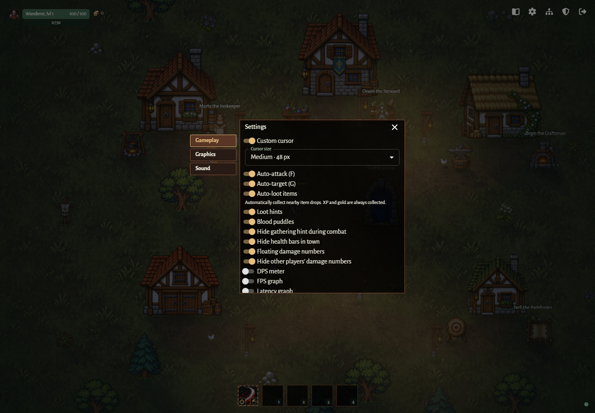

The new client's Gameplay settings include **Debug mode: show hitboxes**, disabled
by default and persisted locally. It takes effect immediately in village, training
and forest at every graphics preset. Show whole-model damage circles and projectile
hitboxes, scenery collision shapes, and labeled attack, splash, collection and interaction
ranges. Omit feet zones and projectile terrain zones. Use the shared simulation's model
dimensions for damage bodies and rule dimensions for other shapes. Decorative critters,
blood, labels and particles have no hitboxes. Outlines follow displayed positions
and wrapped camera geometry; authoritative server positions still decide hits.

[FREE fantasy music by TimberwolfGames](https://timberwolfgames.itch.io/free-fantasy-music) supplies six CC0 tracks: Intro / Theme_001 (start), In The Woods / Adventure (village), and Trials / Wastelands (combat). Each two-track playlist repeats indefinitely and resumes its selection when returning to an area. Music crossfades between areas, starts after a user gesture, pauses in hidden tabs, and has independent enable/volume controls. Sampled effects use bounded voice pools and the existing CC0 Ninja Adventure pack. Original licenses and filenames are in `packages/client/public/audio/CREDITS.txt` and `CC0.txt`.

## UI-05 — Input and display details

Movement uses physical keyboard codes, so WASD works with non-Latin layouts. Text entry and open modal dialogs suppress movement and gameplay hotkeys. The game suppresses native text selection and the browser context menu on its surface. Modal keyboard focus, Escape and focus restoration use the shared UI components. Visible fractional stats, XP, DPS and damage are rounded to whole numbers without changing the underlying values; status meters retain actual units for assistive technology.

Screen-edge arrows point to living teammates in the same area, the boss and return portals using wrapped distances. Enemy deaths retain their sprite and fall/fade for 0.7 seconds. See [combat readability](graphics.md#graphics-04--combat-readability) for debuff icons and weapons.

## UI-06 — Inventory and trading (new runtime)

The Inventory HUD action and physical `KeyI` open a draggable inventory dialog in
village and forest. `I` toggles it closed; Escape and the close button also close
it. Ignore repeats, modified shortcuts, text entry and other open dialogs. Use
the existing modal focus, movement suppression and persisted drag-position rules.
New-runtime windows use a wardrobe-brown solid border, with no divider under the title.

The Inventory window opens with physical KeyI or the HUD action. Compact square backpack slots use item art when available and default equipment-slot art otherwise. Stack counts sit at the bottom right. Item tooltips share a compact 250px layout with the item artwork, name, type and gold price. Consumables show their effect and stack quantity; resources show their quantity without an equip/use hint. Contextual footers show equip, unequip, use, buy, sell, deposit or withdraw only where that action is available. Prices in inventories are per item. Right-click activates an item; Enter or Space provides the same action for keyboard users. Marta and Bram open two compact backpacks, the merchant's on the left and the player's on the right, each with the same gold display used in the HUD.

Gear that the current class cannot equip shows a red “Your class cannot equip
this item.” line in its tooltip, including trader and storage inventories. Its
normal backpack tooltip omits the equip hint; trade and storage action hints stay
available. The warning updates when the current class changes.

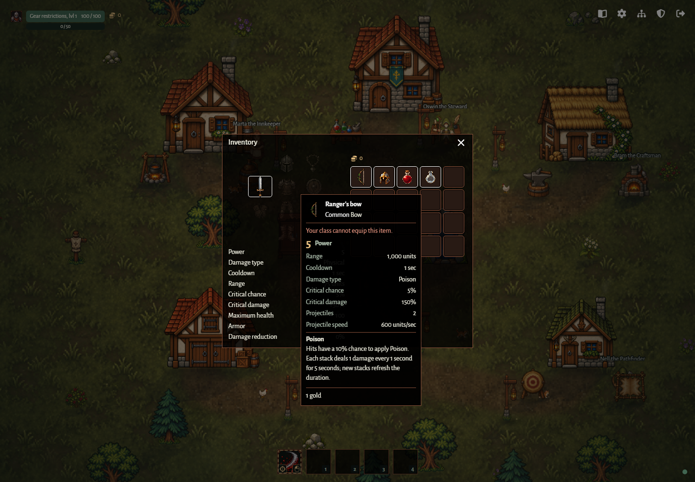

The left side has three columns: weapon/gloves; helmet/body armor/leggings/boots;
amulet/off-hand/ring. All cells are equal squares in a fixed three-column, four-row
base grid, with aligned sides and equal gaps. Equipment cells are 52.8px per side,
exactly 1.2 times the 44px backpack cells. Equipped slots retain their rarity border;
empty slots have no border. Empty slots show generated wardrobe-style
equipment icons at 15% effective opacity; equipped weapons keep their full-brightness
icon. Hover, focus or touch exposes a narrow translucent-black item tooltip with
cream text, thin brown borders and the existing game font. Weapons show prominent
Power, readable label/value rows and an amber effect heading with its explanation.
Armor highlights its Armor value. Tooltips render outside the window's scrollable
content without being clipped by its edges; unusually long details scroll inside
the tooltip. Keyboard access to detailed stat explanations stays within the modal.
Each stat row retains its weapon-specific explanation on hover or focus.
Range follows the active auto-target/cursor-aim mode. Empty slots explain accepted
gear types. Character stats derived from all equipment
appear in a separate Stats tab; Equipment is the default tab. Both tabs use the
external left rail shared with Codex and NPC windows. The 20-slot backpack and
gold remain visible on the right in either tab. Stats show calculated totals,
including gear bonuses, without separate “Bonus…” rows. Attack timing is shown
only as cooldown, without a duplicate attack-speed row.

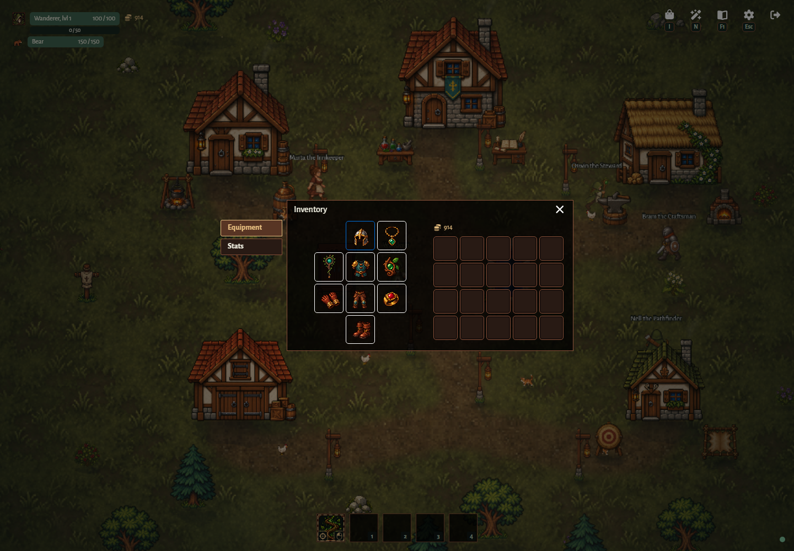

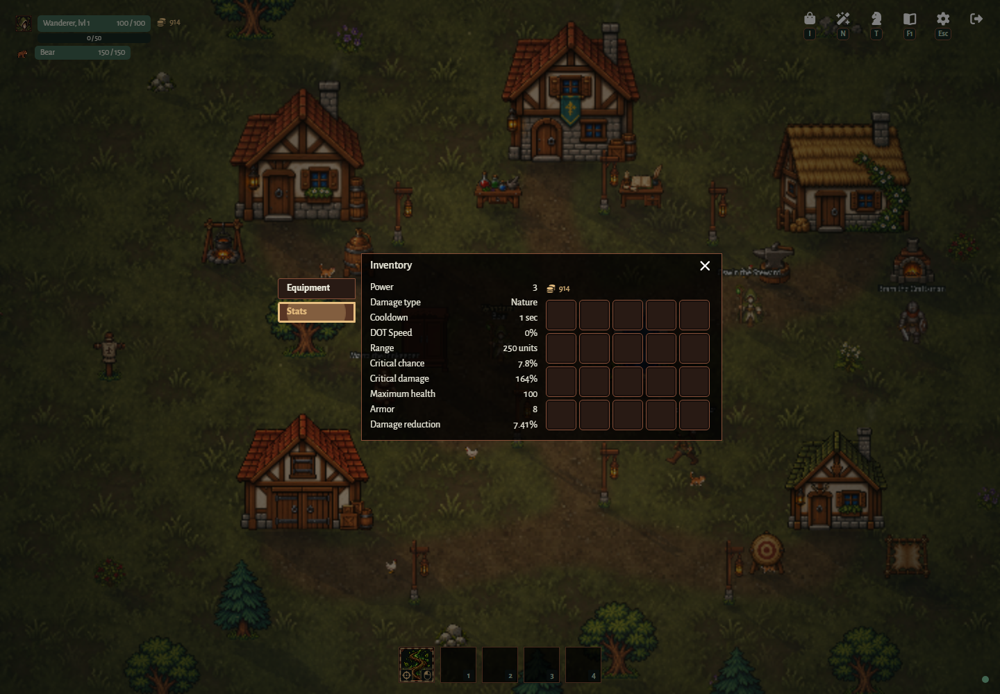

Verified gameplay captures from [equipment.spec.ts](../../tests/equipment.spec.ts).

Unequipped compatible gear includes a compact comparison against the item in the
slot that equipping would replace. Signed green gains and red losses cover base
stats and rolled bonuses, including bonuses absent from the candidate. Equal
items show “Same stats”; empty slots compare against zero. This also applies in
trading and storage. Comparison replaces the standalone primary and bonus stat
rows and has no heading; item identity, effect descriptions, price and action
remain visible. Stat labels omit the “Bonus” prefix in item details and comparisons. Consumables and class-incompatible gear omit comparison.

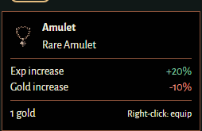

Normal outgoing damage numbers use physical parchment, fire orange, poison lime
and nature green. Critical numbers override the type color with white text and a
thick red outline. Server events carry damage type and critical outcome in both
training and forest; the existing damage-number preference applies.

## UI-07 — Storehouse

Interacting with the existing village Storehouse opens three storage tabs alongside
the backpack and the account's shared gold balance. The HUD and trader show that
same balance. Each tab displays exactly 40 slots. Right-click a tab to open a rename
dialog; F2 on the focused tab provides the same keyboard action. Enter saves and
Cancel or Escape preserves the name. The compact rename dialog uses the shared game
window style and an unclipped storage-name placeholder, without validation helper text.
Names must be nonempty after trimming, with no character-count limit. Long tab names
stay on one line and end with an ellipsis; their full names remain accessible.
Right-click, Enter or Space on an item transfers the whole stack. The existing
window, item icons, tooltips, scrolling and narrow-viewport behavior are reused.

## Acceptance

- Drag an item between the visible backpack and Storehouse or vendor inventory.
  Storehouse moves whole stacks; vendor drops buy/sell one item, up to 10 with
  Shift, or the whole selected stack with Ctrl (which takes priority over Shift).
  The same modifiers apply to vendor RMB and Enter/Space, including Buyback.
  Prices scale per item. Dropping onto another storage tab moves the whole stack to that tab;
  dropping a backpack item onto a storage tab deposits there. Cancelled drags,
  same-inventory drops and unrelated browser drags do nothing. Server rejection
  (full destination, insufficient gold, stale item or invalid proximity) preserves
  items and gold. RMB and Enter/Space remain alternatives. Dragging does not equip
  or consume items, reorder slots or move merchant stock between Buy/Buyback.

- In the new runtime, all four classes receive only their base weapon, including
  migrated saves. All equipped items affect combat and the displayed totals.
- Equipment supports non-Latin `KeyI`, drag/reopen, Escape, typing suppression,
  keyboard tooltips and narrow viewports.
- Critical boundaries, fractional damage, training/forest, saves and network
  reconstruction preserve damage type and critical metadata.

- Toggle F/G once per press, ignore typing/repeats, persist choices and stop held manual casting after release, blur or hiding the tab.
- Drag and reopen windows, navigate Codex tabs with arrows/Home/End, close with Escape and restore focus.
- Boss HUD stays readable offscreen and disappears on defeat/return. The DPS meter toggles independently of performance traces, applies immediately and retains its saved visibility after reload.
- Graph lines distinguish ping, input acknowledgement and local snapshot age; missing samples leave gaps.
- Unlock audio with a gesture, transition through all three music areas, repeat playlists, mute independently and pause hidden tabs.
- Check desktop/narrow layouts, reduced motion, non-Latin movement, large numbers and context-menu suppression.

Evidence: [dps-meter.spec.ts](../../tests/dps-meter.spec.ts), [hud.spec.ts](../../tests/hud.spec.ts), [keyboard-layout.spec.ts](../../tests/keyboard-layout.spec.ts), [rendering.spec.ts](../../tests/rendering.spec.ts), [ui.spec.ts](../../packages/ui/tests/ui.spec.ts).
