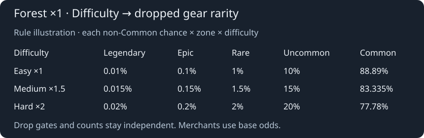
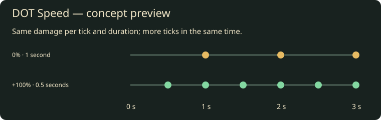
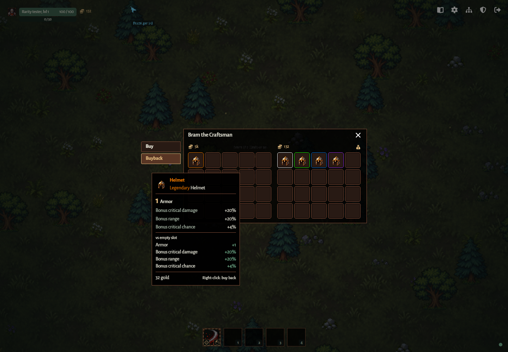

# Item rarity and random stats

## ITEM-01 — Rolled gear

New dropped gear and merchant-generated gear receive one server-owned rarity roll:
Legendary 0.01%, Epic 0.1%, Rare 1%, Uncommon 10%, Common the remaining 88.89%.
For dropped gear, multiply each non-Common chance by the zone factor and the
scene difficulty factor. Forest uses ×1, Swamp ×1.3 and Desert ×1.6; Easy uses ×1,
Medium ×1.5 and Hard ×2. Dimension factors compose with difficulty: Swamp Hard
is ×2.6 and Desert Hard is ×3.2.
Common takes the remaining probability. Thus Forest Medium yields Legendary
0.015%, Epic 0.15%, Rare 1.5%, Uncommon 15%, Common 83.335%; Forest Hard yields
0.02%, 0.2%, 2%, 20% and 77.78% respectively. Merchant-generated gear retains
the base odds. Existing gear is never rerolled when difficulty changes.

Existing item drop gates/counts remain independent. All four weapons join the loot
pool using their existing definitions and dedicated artwork. Resources and consumables
are Common and do not roll gear stats. Existing items retain their intrinsic stats,
default to Common, and never receive retroactive rolls.

Common/Uncommon/Rare/Epic/Legendary gear has 1/1/2/2/3 distinct random stats, in
addition to its intrinsic stats. Sample without replacement: regular weight 1,
eligible legendary-only stat weight 0.2. No extra value variance or rounding.
The rarity multipliers are 1/1.2/1.4/1.7/2. Special stats never scale.

| Stat               | Base | Units                              |
| ------------------ | ---: | ---------------------------------- |
| Attack speed       |    2 | percent                            |
| DOT Speed          |    2 | percent tick frequency             |
| Critical chance    |    2 | percentage points                  |
| Critical damage    |   10 | percentage points of normal damage |
| Power              |    1 | flat                               |
| Armor              |    1 | flat                               |
| Maximum health     |    5 | flat                               |
| Gold increase      |   10 | additional-drop chance percent     |
| Exp increase       |   20 | additional-drop chance percent     |
| Movement speed     |    3 | percent                            |
| More projectiles   |    1 | fixed additional projectile        |
| Projectiles bounce |    1 | fixed additional bounce            |
| Projectile pierce  |    1 | fixed additional penetration       |
| Additional attack  |    1 | fixed additional attack            |
| Area of effect     |   10 | percent radius/reach               |
| Range              |   10 | percent targeting/travel range     |

Gold Increase and Exp Increase are eligible on every gear type, alongside:

| Type                       | Other regular stats                                                    | Legendary-only stat |
| -------------------------- | ---------------------------------------------------------------------- | ------------------- |
| Sword                      | Power, attack speed, DOT Speed, critical chance/damage, area, range    | Additional attack   |
| Bow                        | Power, attack speed, DOT Speed, critical chance/damage, range          | Projectile pierce   |
| Fire staff, mage orb       | Power, attack speed, DOT Speed, critical chance/damage, area, range    | More projectiles    |
| Nature staff, nature focus | Power, attack speed, DOT Speed, critical chance/damage, area, range    | Projectiles bounce  |
| Shield                     | Armor, maximum health, power, attack speed, DOT Speed, area            | Additional attack   |
| Quiver                     | Power, attack speed, DOT Speed, critical chance/damage, range          | Projectile pierce   |
| Gloves                     | Armor, maximum health, power, attack speed, DOT Speed, critical chance | —                   |
| Helmet                     | Armor, maximum health, critical chance/damage, range                   | —                   |
| Body armor                 | Armor, maximum health                                                  | —                   |
| Leggings                   | Armor, maximum health, movement speed                                  | —                   |
| Boots                      | Armor, maximum health, movement speed, range                           | —                   |
| Amulet                     | Power, maximum health, critical damage, area                           | —                   |
| Ring                       | Power, armor, attack speed, DOT Speed, critical chance/damage          | —                   |

## ITEM-02 — Equipped effects and drops

DOT Speed is a regular affix on gear that can roll attack speed. It sums across
equipped slots and uses the usual rarity multipliers and weight 1. Bleed, poison
and burn tick every `1000 / (1 + DOT Speed / 100)` milliseconds; +50% means one
tick every 666.67 ms. Player, Bear and talent-applied ailments use the owner's
bonus when the effect starts and retain that interval until it expires. Refreshing
stacks extends duration without restarting the tick timer. Damage per stack,
duration, attack/cast cooldowns, roots, silence and scheduled talent pulses are
unchanged. Existing gear without this affix retains its original behavior.

Concept preview, not a gameplay capture. Verification: [DOT Speed rules](../../packages/server/src/dot-speed.test.ts)
and [desktop presentation](../../tests/dot-speed.spec.ts).

Equipped bonuses sum across slots, including weapon and off-hand. Percent bonuses
sum before multiplication. Critical chance caps at 100%. Hunter retains the saved
class ID `ranger`; each base arrow penetrates three targets after its first hit
(four hits total), plus equipped pierce. Mage projectile count and Druid bounce
count add their respective bonuses. Warrior extra attacks deal full damage and
roll critical and on-hit effects independently. Compatible offensive talents
receive the same extra attacks/projectiles/target penetrations/bounces; area,
range, power, critical and attack speed also affect compatible talent effects.
Training uses the same rules and grants no rewards.

For each kill, sum Gold/Exp Increase across the killer's whole party, counting
each member once, without requiring damage credit. The server evaluates this
once at drop generation. Each full 100% guarantees an extra copy of the original
gold/XP drop; the remainder rolls for another. Gold bonus rolls require the
original gold drop gate to succeed. Copies never generate further copies.
The original killer XP credit and pickup distribution remain unchanged.

## ITEM-03 — Identity, compatibility and presentation

Rolls survive pickup, equip/replacement, unequip, all storage transfers, sale,
buyback, class switching, reconnect and server restart. Invalid stat names,
values, rarity/type combinations and incompatible equipped instances are rejected
at save boundaries. Clients cannot choose rolls or reward bonuses.

Every item slot uses its rarity border, including equipment, backpack, Storehouse,
merchant and buyback. Item drop beams share the same color: Common white
`#ffffff`, Uncommon green `#1eff00`, Rare blue `#0070dd`, Epic purple `#a335ee`,
Legendary orange `#ff8000`. Tooltips identify rarity and every rolled stat.

Verification: [roll rules](../../packages/server/src/item-rolls.test.ts),
[persistence checks](../../packages/server/src/item-roll-persistence.test.ts),
[combat effects](../../packages/server/src/item-roll-combat.test.ts),
[talent and party rewards](../../packages/server/src/item-roll-talents-rewards.test.ts)
and [desktop inventory/storage/trading checks](../../tests/item-rarities.spec.ts).

## ITEM-04 — Gear prices

Gear uses one per-item gold price for buying, selling and buyback, including
Sell all, quantity modifiers, storage and equipped-item tooltips. The price is
`ceil(base price × rarity multiplier + 5 × stat score)`. The rarity multiplier
uses the existing Common 1, Uncommon 1.2, Rare 1.4, Epic 1.7 and Legendary 2
values. Each rolled stat contributes `value / stat base value / stat weight`
to the score: comparable stat units have comparable value, larger bonuses cost
more, and scarce legendary affixes command a premium. Missing roll metadata
means Common with no added stat score; intrinsic definition stats are unchanged.
Consumable and resource prices retain their definition value (default 1 gold).
All prices and resulting balances must be safe integers; rejected transactions
leave items and balances unchanged.

Bram sells rolled gear; Marta sells consumables and resources. Both support
selling and independent buyback lists. Verified desktop gameplay capture:

Evidence: [merchant rules and command tests](../../packages/server/src/merchant-pricing.test.ts),
[desktop rarity and buyback test](../../tests/item-rarities.spec.ts).
