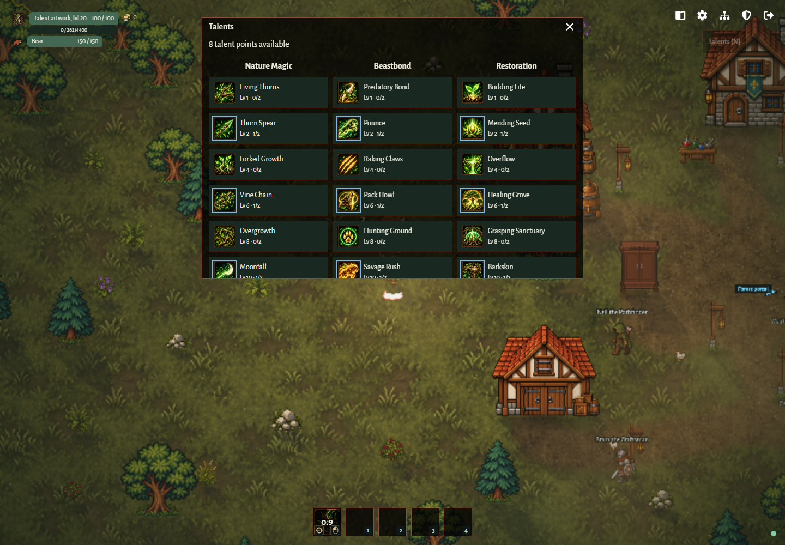
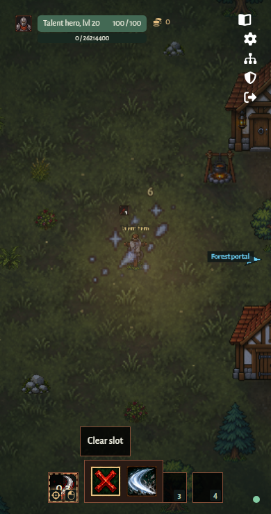
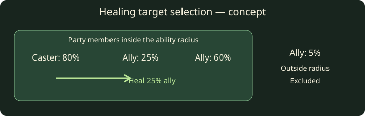

# Progression without interruptions

Status: implemented automatic per-class leveling and paragon progression. This document replaces the suggestion to choose one of three upgrades on each run level.

## PROG-01 — Uninterrupted progression

Automatic level and XP grants must not require the player to stop playing, open a selector, make an upgrade choice, or confirm a reward. Talents are a voluntary configuration exception: players may spend earned points from N at any time; no level-up opens the window or waits for spending. Moving the selector to a small panel while combat continues still requires a choice and does not meet this requirement. A teammate's progression must not pause the shared game or wait for a party vote.

Any future progression feedback must leave movement, targeting and attacking available. Optional information may be shown without taking focus or requiring dismissal. This constraint concerns progression; existing voluntary settings, wardrobe selection, portal readiness and exit dialogs remain separate features.

## Current behavior

- XP is granted through kill credit and shared pickups. The server automatically spends XP on level-ups without an upgrade offer.
- Level, paragon, unspent XP and reserved talent data are saved independently for each class, surviving death, scene returns, class changes and reconnects through the existing save lifecycle.
- In the new runtime, each gold pickup adds one coin to its account's shared Storehouse balance without a prompt. Coins can be spent or earned through optional Innkeeper trading in the new runtime.
- The wardrobe changes class in the village. It is not a progression reward flow.

See [characters](characters.md) and [combat rewards](combat.md#combat-05--rewards-and-damage-accounting) for implemented rules.

## PROG-02 — Automatic levels and paragon

New characters start at level 1, paragon 0. The next level-up requires
`50 * 2 ** (level + paragon - 1)` XP: 50, 100, 200, and so on. Every affordable
level-up is applied, retaining fractional unspent XP. Normal level stops at 20;
further level-ups increase paragon without a cap, continuing the exponential curve.
Level-ups do not change health, stats or abilities.

Older saves without paragon start at 0; legacy levels above 20 become level 20
with the excess added to paragon. No other progress is reset. The existing
five-second autosave, disconnect and shutdown policy applies to all progression.

Party cards show a thin XP bar beneath health with current/required XP. The
normal level and, when positive, paragon level are visible. The client only
displays server-confirmed progress and uses the shared requirement formula.

## PROG-03 — Talents

Each class has three independent columns with ten rows. Rows unlock at normal
levels 1, 2, 4, 6, 8, 10, 12, 14, 16 and 18. Every talent has two ranks, costing
one point per rank. There are no prerequisite nodes or required column spending;
extensions may be purchased before the abilities they affect. Talents change
combat mechanics rather than permanently increasing character stats.

The earned point budget equals normal level, including one point at level 1 and
20 at level 20; paragon grants none. Unspent points equal that budget minus valid
spent ranks. N or the HUD opens the voluntary three-column window. Each node
shows its rank and level, with themed tooltips describing both ranks and affected
abilities. Level-up never opens this window or waits for allocation.
Only learned talents have a visible card border. Unlearned talents have no visible
card border, whether available or locked; keyboard focus remains outlined.
Active ability icons have a blue outline and an active-ability tooltip hint;
passive icons keep their existing presentation. Both the tree and action bar
crop artwork to its authored frame, without neighboring icon strips.

Every column has abilities in rows unlocked at levels 2, 6, 10 and 14. Rank 1
unlocks an ability; rank 2 improves its effects. Left-clicking an action-bar slot,
or pressing F2 while it is focused, opens an icon picker of learned abilities and an equally sized generated red X
clear tile. Names remain available in tooltips and accessible labels. Four slots can be assigned independently. Cooldowns belong to the
ability, so assigning it to another slot or to multiple slots cannot bypass its
cooldown. Assignments and ranks save independently per class; the server validates
ownership, life, class, area epoch, training eligibility and cooldowns.

Right-clicking an equipped ability toggles its browser-saved auto-cast choice.
The saved Auto-attack option (F) is the master switch; disabling it pauses talent
auto-casts without clearing those choices. RMB on the base ability toggles that
master switch. Enabled abilities show an animated dashed border, steady under
reduced motion. Manual casts use 1-4. Talent auto-casts request the existing
server-validated cast at most once per slot per 250 ms when ready, alive, equipped,
and in the forest or training area. Open game windows and the picker, unavailable
connections, and hidden tabs pause requests. Aim uses the existing cursor aim.

Warrior columns are Weapon Mastery, Bloodletting and Guardian. Open Wounds adds
20 or 35 percentage points to the existing weapon Bleed chance. Ranger columns
are Marksmanship, Venom and Survival; Mage columns are Fire, Arcane and Frost
Ward; Druid columns are Nature Magic, Beastbond and Restoration. Every third
column provides defensive effects. Beastbond commands require a living Bear.
Effects use shared authoritative forest/training combat and wrapped geometry;
training never grants rewards. Cast feedback uses class/column animation sheets
and particles from confirmed events. The catalog and tooltips define the current
rank effects; they are initial balance values.

Targeted healing chooses the living injured party member with the lowest
remaining health percentage within the effect's wrapped radius, including the
caster. Equal percentages retain player order. Mending Seed and Renewal use
their registered 700-unit range around the caster; Healing Grove chooses one
recipient per second within 200 units of its fixed cast position. Healing
opportunities choose one recipient within 60 units of the consumed enemy.
Disconnected players, players in other areas or forest runs and players outside the caster's party
are excluded. Solo players can heal themselves. Passive self-healing and Bear's
own heal retain their dedicated recipients; Renewal's damage reduction stays
on the caster. No eligible recipient means no healing, without refunding the cast.

The village bullseye retains its 50-account-coin reset, living-character and
proximity requirements, and save-before-publication transaction. Reset refunds
spent ranks and clears equipped abilities. Existing ability cooldowns remain.
Allocation version 2 refunds all old talent trees once, for every saved class,
including offline players when their save is loaded. Normal level, paragon, XP,
items, account currency and identity are preserved. Invalid class allocations,
locked ranks and over-budget records are refunded rather than granting effects.
The migration is idempotent, so new valid allocations survive later loads.

## Acceptance for any future implementation

1. Cross a progression threshold while moving and attacking: inputs continue, no modal or choice appears, and rewards do not wait for confirmation.
2. Cross multiple thresholds or earn rewards during a reconnect: each server-owned grant occurs once without an input prompt.
3. With two clients, one player's progression does not pause or block the other.
4. Optional feedback does not steal keyboard focus, obscure necessary threat information, or require dismissal; reduced-motion preferences apply.

Coverage: [server progression tests](../../packages/server/src/progression.test.ts)
and [XP HUD and rejoin scenario](../../tests/progression.spec.ts). These references
describe coverage; execution evidence is reported separately.
