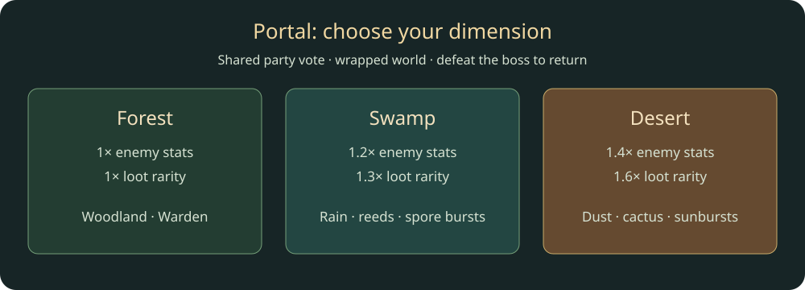
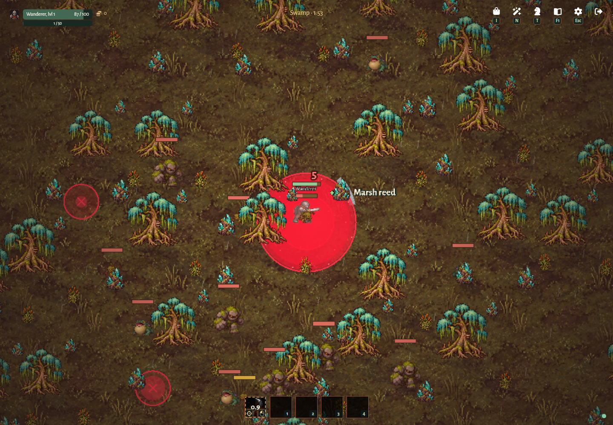
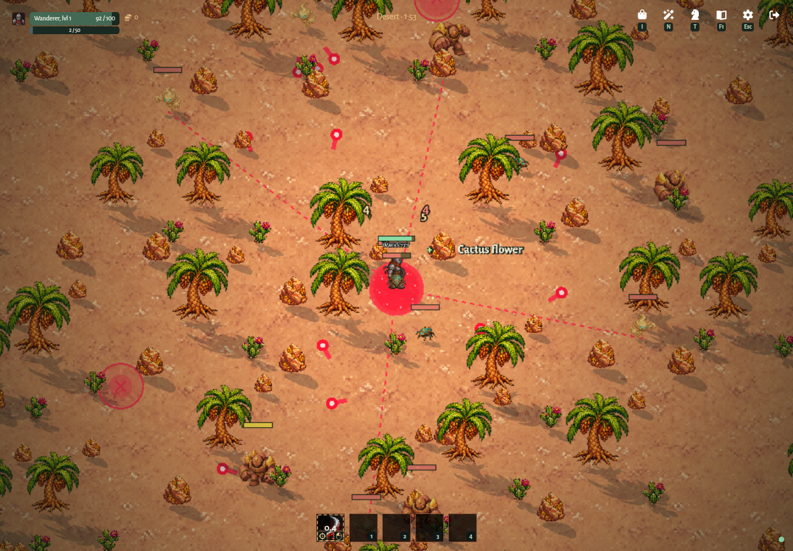

# Geometry, forest entry and completion

[Back to Village and forest scenes](../scenes-and-village.md).

## SCENE-02 — World geometry

The lobby and generated forest are each 4800×2560 and wrap on all four edges. The lobby is 20 times its original area (five times the width and four times the height). Its camera always centers the local character, including while training or crossing an edge; terrain, scenery, players, companions, combat effects, cursor aim, and navigation use the nearest wrapped positions. The original village buildings, wardrobe, portal, and training dummies keep their positions, with extra terrain and vegetation around them. Both areas share the same dimensions so combat and interpolation use the same wrapped distances. Tree generation and nearby-cell collision queries are shared; combat distances and client interpolation also wrap.

Players move through scenery in both areas; enemies and companions retain tree steering and collision. WASD or arrows move at 180 world units/second with normalized diagonal speed.

## SCENE-03 — Voting and entry

When the lobby's Portal is off-screen, a blue edge arrow labeled Portal points toward its nearest wrapped position, using the same navigation presentation as the Warden. The arrow hides while the portal is on-screen and is not shown in the forest.

The village Portal offers Forest (default), Swamp and Desert, each with Easy (default), Medium and Hard difficulties. The departure vote shows the selected dimension and difficulty. See [SCENE-07](#scene-07--dimensions) for dimension content and modifiers. The registered difficulty multipliers (1×, 2× and 4× respectively) scale enemy health and damage, including elites and the boss, before party health scaling. The selected difficulty is submitted to the server and shown in the departure vote. Creating allocates a server-owned scene before entry. All current party members (or the solo player) must vote ready, including sessions retained during the disconnect grace period; unanimous readiness starts a five-second countdown. Retracting a vote cancels it. Joins invalidate unanimity; departures restart the countdown with the remaining electorate. At completion, the server teleports the party together and starts a 120-second run. Players may join a world at any time, subject to its password and capacity. Late joiners arrive in the village and can use its portal to join the active scene; players who return early can rejoin the same way. Joining uses the existing scene and deadline, including while the boss is alive. An unfinished scene stays joinable even when every participant returns to the village. Once the boss dies and return portals open, entry is closed; no living players may remain inside before a new scene can be created. Each party or solo player has an independent scene; world departure resets temporary parties. Party members in another dimension use 40% opacity (60% transparency); members in the same dimension remain fully opaque.

Clicking I'm ready closes the portal dialog; the Portal vote button reopens it to retract. The five-second departure countdown displays large gold digits that grow and fade each second, with animation disabled for reduced-motion preferences. Regular enemy spawning continues through the boss encounter; boss death alone completes the scene and clears hostiles.

## SCENE-04 — Pause and regeneration

When no living players remain in a generated scene (everyone died or left; interrupted connections retain membership during the existing recovery window), combat and scene time pause. Enemies, projectiles, spawn warnings, debuffs, loot expiry, and companion actions wait; rejoining resumes their remaining durations and the boss timer. Living village players do not keep the forest running. The village portal still allows rejoining an unfinished scene and also offers Regenerate scene while no living players are inside. The active scene's Regenerate scene button preserves its dimension and difficulty. Regeneration replaces the old scene with a fresh departure vote and returns any dead participants to the village with restored stats. The server rejects regeneration during voting/countdown or while even one living player remains inside.

## SCENE-05 — Boss and return

At timer expiry, regular spawning continues and one Brute Boss with 300 Easy HP before party scaling with an orange health bar appears. The scene stays active until the boss dies; only then do remaining enemies disappear and a fixed blue return portal appears at each participant's feet, including players far from the original clearing. E near it returns a player to the village. A dead player can return immediately using their death window while teammates continue. The exit control opens a confirmation: leaving a scene returns to the village without removing party membership; leaving the village exits the world. Escape opens Settings, or closes the current window first.

## Acceptance

- Every current party member must be ready; retracting cancels departure, joining invalidates unanimity and departures restart the five-second countdown.
- Enter together, or join the active scene late without resetting its deadline. Boss defeat closes entry.
- Cross all four seams in village and forest: player, camera, aim, scenery and navigation stay aligned.
- Pause an empty/dead scene, advance the test clock, then rejoin: its remaining timers resume rather than expiring during the pause.
- Regeneration rejects a scene with a living participant and rejects voting/countdown; eligible regeneration restores dead participants and starts a new vote.
- After 120 seconds the boss spawns; regular spawning continues until boss death. Each participant receives a fixed nearby return portal.
- Early scene exit retains world membership; village exit removes it. Buildings remain service placeholders.

Evidence: [scene transitions](../../../packages/server/src/scenes.test.ts), [voting](../../../packages/server/src/scene-voting-lifecycle.test.ts), [pause/resume](../../../packages/server/src/scene-pause-resume.test.ts), [difficulty](../../../packages/server/src/scene-difficulty.test.ts), [pass-through.test.ts](../../../packages/server/src/pass-through.test.ts), [village.test.ts](../../../packages/server/src/village.test.ts).

## SCENE-07 — Dimensions

Forest, Swamp and Desert use the same wrapped 4800×2560 geometry, 120-second
encounter, five-second party vote, pause/rejoin rules and boss-completion return
portals. The village interaction, navigation arrow and window are named Portal.
The party leader chooses the dimension before creating a run; regeneration from
an unfinished run preserves the dimension. Legacy commands without a dimension
create Forest. Unknown dimensions are rejected by the command schema.

| Dimension | Enemy stat multiplier | Equipment rarity multiplier | Resources                                                        |
| --------- | --------------------- | --------------------------- | ---------------------------------------------------------------- |
| Forest    | 1                     | 1                           | Existing forest trees, plants, rocks and drops                   |
| Swamp     | 1.2                   | 1.3                         | Cypress → Bogwood; reeds → Marsh reed; peat stone → Peat crystal |
| Desert    | 1.4                   | 1.6                         | Palm → Palmwood; cactus → Cactus flower; sandstone → Sunstone    |

Enemy modifiers multiply health, damage, movement speed, projectile speed,
attack range and ability radius. Windup and cooldown divide by the modifier,
so attack speed increases by that factor. Body size, collision size, spawn
warnings and the shared incoming-hit immunity interval stay at their base values.
Difficulty and party multipliers compose with these modifiers. Area modifiers
scale the radius/reach parameter, as equipment area bonuses do.

Swamp has wet mud ground, cypress trees, reeds and peat-crystal rocks, rain and
low green mist. Mirelings mark a small lunge area, Bog toads mark a wider spore
burst at the target's position, and Moss golems stomp around themselves. Their
marked ground areas remain fixed through windup and can be dodged. The Mire
Matriarch is the swamp boss.

Desert has sandy ground, palms, cactus and sunstone-bearing sandstone, drifting
sand and warm dust haze. Scarabs bite quickly, Sand wisps fire a three-shot
fan, and Dune colossi release eight-shot radial sunbursts. The Sunstone Sovereign
is the desert boss. Projectiles preserve launch-time damage and use shared
wrapped collision. Each new enemy and resource has dedicated generated artwork.
Weather respects particles/fog settings and does not change combat rules.

Higher-quality equipment rarity intervals multiply by the dimension's rarity
modifier; Common receives the remainder. This changes quality, not item drop
chance, item count, gold, XP or merchant gear. Resources remain Common. New
resource nodes grant one corresponding item per completed gather; trees retain
five gathers and all nodes retain the existing one-hour restore/atomic inventory
rules. Their IDs are distinct across dimensions and depletion is run-local.

This diagram describes content and rules, not a verified gameplay capture.

Desktop captures from the production build on 2026-11-01. The test-owned server
positions the character beside a resource; portal choice, entry, gathering,
boss combat and return use the real client/server flow. These captures verify
presentation, not a performance benchmark.

Coverage: [dimension lifecycle and modifiers](../../../packages/server/src/dimensions.test.ts),
[enemy abilities](../../../packages/server/src/dimension-attacks.test.ts),
[resource drops and save compatibility](../../../packages/server/src/dimension-resources.test.ts),
and [desktop portal and biome checks](../../../tests/dimensions.spec.ts).
