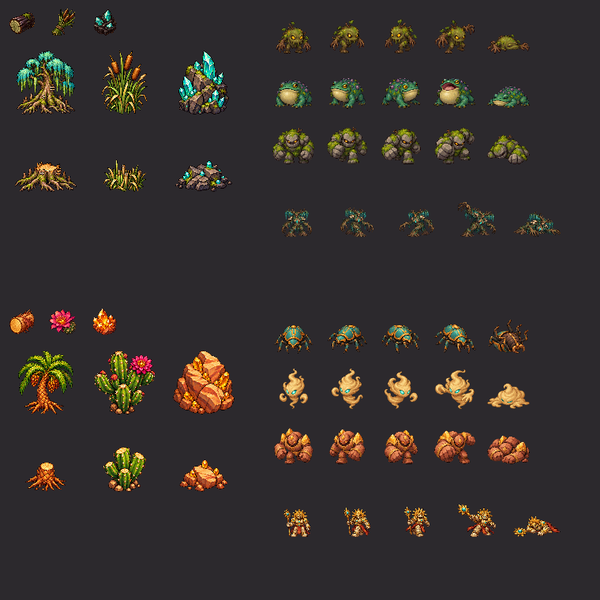

# Swamp and desert artwork

Generated on 2026-11-01 by the delegated GPT-6 Astra artwork agent using the
built-in OpenAI `image_gen.imagegen` tool. The tool does not disclose its
underlying image-model identifier. No CLI fallback or procedural replacement
art was used. Existing wardrobe-style `environment.png`, `brute.png`, and
`item-log.png` were visually inspected to guide the warm outlined painted style;
they were not copied into these assets.

## Layout

| Files                        | Export dimensions | Layout                                                        |
| ---------------------------- | ----------------- | ------------------------------------------------------------- |
| `{swamp,desert}-terrain.png` | 2172 × 724        | Three 724px ground variants, left to right                    |
| `{swamp,desert}-items.png`   | 2172 × 724        | Three 724px cells: wood, herb, mineral                        |
| `{swamp,desert}-scenery.png` | 1536 × 1024       | 512px cells; columns tree, plant, rock; rows intact, depleted |
| `{swamp,desert}-enemies.png` | 1536 × 2560       | 512px cells; columns melee, ranged, brute; five action rows   |
| `{swamp,desert}-boss.png`    | 512 × 2560        | One column, five 512px action rows                            |

Action rows are idle, walk A, walk B, attack, defeated. Enemy columns are
Mireling / Bog Toad / Moss Golem for swamp, and Scarab / Sand Wisp / Dune
Colossus for desert. The separate bosses are Mire Matriarch and Sunstone
Sovereign. Defeated poses are painted images, not rotations of standing art.
Normalized sprite baselines are at 464/512 of each cell. Scale is held constant
within each sprite column across its poses. Runtime facing reflection and action
row selection are separate presentation responsibilities.

Swamp scenery and resources are cypress/bogwood, marsh reeds, and peat crystal.
Desert scenery and resources are palm/palmwood, cactus/cactus flower, and
sandstone/sunstone. Each subject has dedicated independently generated artwork.

## Sources and packaging

Unmodified selected generated sources are preserved in
[`docs/images/dimensions/sources`](../../../../../docs/images/dimensions/sources).
Terrain and items retain their original 2172 × 724 dimensions. Scenery sources
are 1536 × 1024, enemy sources 971 × 1619, and boss sources 793 × 1983.
The full initial prompts are in [prompts.json](prompts.json). Selected source
and placed rectangles, scales and dimensions are in
[packaging.json](packaging.json).

Initial scenery generations contained an unwanted colored backdrop. A second
built-in image-generation edit produced the selected alpha cutouts using this
exact prompt for each scenery sheet:

> Precise background extraction for game sprite atlas: remove ALL background pixels and colored halos completely, leaving ONLY the six isolated illustrated objects with genuine transparent alpha outside each object. Preserve each object exact design, colors, size, sharp outline, and position. Absolutely no backdrop, ambient glow, shadow, floor, or colored fog. This is six cutout sprites in a 3-column 2-row grid, not a scene. Preserve empty spacing. Transparent output required.

Tool option `transparent_background: true` was used for all sprite/item calls
and both background-extraction edits; terrain used `false`. Extraction edits
referenced the initial generated scenery files. Original tool outputs remain
under `E:/projects/.codex/generated_images/01a19764-0341-7d42-81e7-52e8bf556c8c`.

Mechanical packaging used Pillow. Scenery uses measured source rectangles,
visible alpha bounds and nearest-neighbor scaling. Actor sources did not follow
their nominal grid precisely: connected alpha components above 32/255 were
grouped by sprite position, omitting isolated components below 300 source
pixels. Each component mask was expanded by one pixel and multiplied by the
original alpha to retain antialiased boundaries while excluding neighboring
frame fragments. No pixels were painted or recolored. Normalized sprites fit
within 432px in 512px cells; independent assertions checked 16px transparent
gutters on all four edges of every normalized cell. Production downscaling
belongs to the client's Vite asset-size pipeline.

## Inspection and limitations

All selected generated source images were visually inspected. The contact sheet
below composites real alpha over an opaque neutral surface, displaying items at
36px, scenery at 96px, enemies at 64px and bosses at 72px. It confirms distinct
subjects, painted action/death poses, clean separated cells and transparent
backgrounds. It is an asset preview, **not a verified gameplay capture**.

Actual client animation loops, facing behavior, production-copy fidelity and
repeating terrain seams require the integrating task's desktop browser checks.
Generated walk poses are a short two-contact cycle; they are not a complete
multi-direction hand-authored animation set. The terrain prompt requested
seamless tiles, but this asset inspection alone does not establish seam-free
rendering across repeated tiles or different variants.

## Attribution and license

These generated assets follow the wardrobe-style collection's CC BY-SA 3.0
distribution. Retain the collection's
[attribution](../wardrobe-style/README.md),
[LPC credits](../LPC-CREDITS.txt), and [LPC license](../LPC-LICENSE.txt).
Existing unrelated asset licenses are unchanged.
