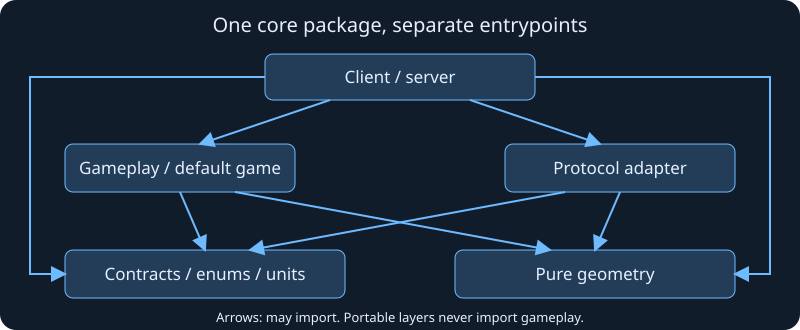

# Portable contracts, geometry and protocol

[Back to Core library](../README.md).

Core contains both portable data layers and content-aware gameplay. Import the
entrypoint that matches the responsibility; importing portable data must never
initialize registries, bundled mods or the default game.

| Entrypoint                  | Responsibility                                                                             |
| --------------------------- | ------------------------------------------------------------------------------------------ |
| `@emberfall/core/contracts` | Serializable entity/content types, structural Zod schemas, collection membership and units |
| `@emberfall/core/enums`     | Named built-in enemy type/kind and difficulty values                                       |
| `@emberfall/core/geometry`  | Content-independent wrap and shortest-delta algorithms                                     |
| `@emberfall/core/protocol`  | Colyseus projection and detached snapshot reconstruction at network boundaries             |
| `@emberfall/core`           | Registries, bundled content, semantic validation and shared gameplay rules                 |

Architecture diagram, not a gameplay capture. Arrows mean "may import"; portable
layers cannot import the gameplay layer. The
[boundary tests](../../../tests/package-boundaries.test.ts) enforce this direction
for relative imports and public subpaths, including re-exports.

## Validation and state

Content IDs are extensible strings. A structurally valid ID is not necessarily
registered: `contracts` checks wire/save shape, while server command and save
boundaries also use core's catalog-aware schemas and rules. Do not replace one
with the other or merge their identically named exports into the root barrel.
Preserve wire/save shapes, IDs and collection membership semantics.

Definitions describe immutable types; entity instances retain mutable IDs,
position, health, deadlines and ownership. Collection additions use
`appendSceneEntities(scene, key, ...values)`; removals replace the array with a
filtered array. Mutate entity fields directly. Server collections are read-only
ordered ECS query views; prediction/tests can supply ordinary objects. Do not
change collection membership with `push`, `splice` or index assignment in a
shared system.

Portable contracts and geometry have no DOM, database, transport or content
dependencies. Protocol adapters depend on portable layers and `@colyseus/schema`;
they open no connections. Content registration, bound world geometry, hitboxes,
equipment/inventory rules and forest/training simulation remain in gameplay.

## Verify

Run affected contract/protocol/geometry tests and `pnpm typecheck`. Shared changes
also need core package checks, server/save tests, production builds and an
affected desktop browser scenario. See [development](../../../docs/development.md).
