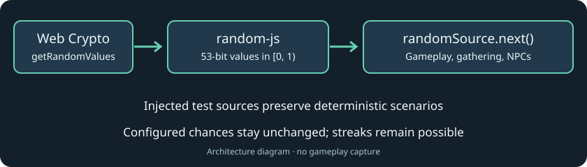

# Registries, mods and startup

[Back to Core library](../README.md).

Code paths in this guide are relative to `packages/core` unless prefixed with another package or repository directory.

## Registries, mods and startup

Engine authoring contracts in `src/content/contracts.ts` are independent of the
base mod. Base attack, enemy, companion and ailment data use `satisfies` to check
their fields without widening their inferred literals. Runtime startup still
validates complete registered definitions and cross-content references.

`content/rules.ts` composes catalog-bound equipment, item, storage, inventory,
merchant and validation modules. Their internal factories share the same sealed
registries and derived helpers; callers continue to use the frozen `rules`
surface returned by `createGame`. Item mutations remain separate from host
transactions, transport and presentation.

Core is the composition root for portable game rules and content. Common supplies
contracts, structural schemas and pure geometry; common never imports core.
`createGame(mods)` creates registries, invokes synchronous registration, validates
references/values, seals content and returns a ready context with `registries`,
`rules`, `modIds` and `status`. Failed startup exposes no partially ready context.
The default `game` uses the explicit `GAME_MODS` list in `src/mods/index.ts`, with
`baseMod` first. Both server and browser initialize that list before gameplay.

`createGame(mods, random)` optionally binds a random function to that context.
Combat criticals, ailments, rewards, item rolls, enemy spawns and scheduled talent
hits use it; training forwards the same context through the shared combat path.
The default reads `randomSource.next()` at each draw. This shared source uses
`random-js`'s `realZeroToOneExclusive(browserCrypto)` for 53-bit values in `[0, 1)`,
backed by `crypto.getRandomValues` in Node 24 and secure browser contexts. Probability
helpers, gathering targets and village NPC behavior use the same default. Configured
chances are unchanged; independent rolls can still produce streaks. Fixed scenery
seeds and credential/UUID generation retain their existing implementations.

Architecture diagram, not a gameplay capture. Probability helpers and item rolls
retain explicit per-call overrides. Seeded sources support isolated outcome
fixtures without switching global state; item UUIDs remain cryptographically
generated, so this is not a complete replay or deterministic identity API.

Tests that exercise default draws mock `randomSource.next`, rather than
`Math.random`. The [source checks](../src/utils/tests/random.test.ts) cover Web Crypto
refills and `[0, 1)` boundaries; the
[context checks](../../server/src/random-context.test.ts) cover isolated injected
sources through shared gameplay.

`src/mods/base/worlds/village-residents.ts` holds resident identities, workstations
and conversation topics. `village.ts` composes those with geometry and scenery;
its compatibility exports and definition values stay stable.

`src/mods/base.mod.ts` registers shipped content from its private `base/` data
modules. `src/definitions` and balance configs expose derived views for consumers;
edit source content through the mod, not these views. `src/content` owns registry
contracts, validation and bound equipment/inventory rules. World helpers,
hitboxes, combat, enemies and training live in core. Export APIs from `src/index.ts`
or the declared definition/hitbox subpaths. The [design](../../../docs/design/mods.md)
describes ownership, saved IDs, supported mechanics and validation boundaries.

Registries expose `size`, `has`, `get`, `require`, `values` and `entries`.
Registration receives only `register` for each registry. Definitions are copied
and deeply frozen, IDs cannot overwrite earlier entries, and retained registration
handles close even after failure. Do not import the default `game`, its derived
views or the root core barrel inside a bundled mod: that creates a composition
cycle. Import `GameMod` as a type from `../content/contracts.ts`, and use plain
standalone data or shared mod-owned templates.

`ItemDefinition` is a discriminated union. Gear uses `kind: 'gear'` with
`gearType` and `stats`; consumables use `kind: 'consumable'` with `healing`.
Resources use `kind: 'resource'` and stack to 200; gear never stacks. Consumables need no dummy gear fields. `BaseItemDefinition` carries `id`, `name`
and optional `price` (a safe nonnegative integer in gold units). `EnemyKind` is an open string type while the named built-in
constants retain their original values.
