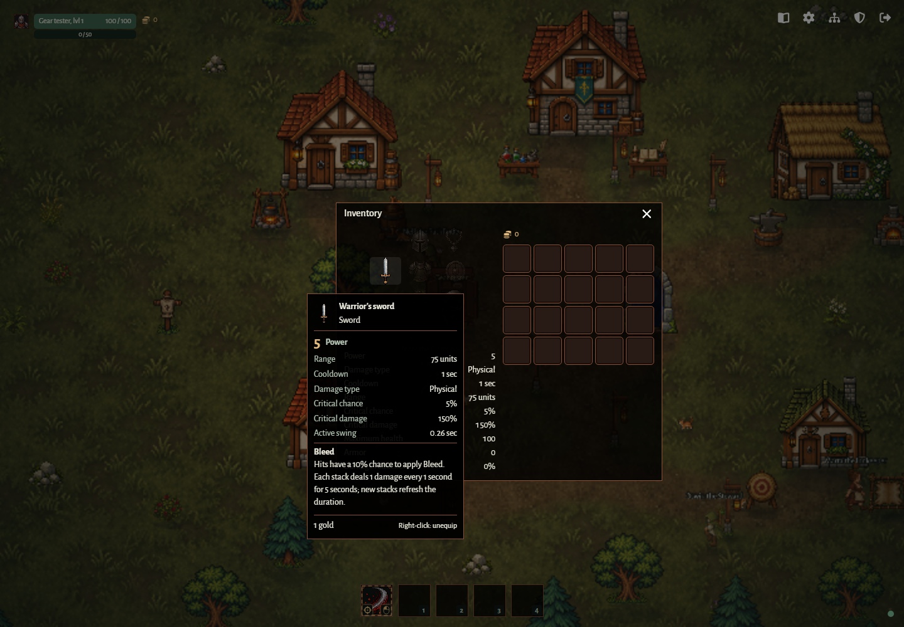

# Emberfall UI

A source-exported React component library used by the game client and Storybook. Storybook is the review surface; its screen examples use local demo state and never connect to a game server.

## Run and verify

`Backpack` and `EquipmentPanel` accept host-supplied item `rarity` labels and
`rarityColor` values. Filled slots retain this border on hover; `ItemTooltip`
shows the label and colored name alongside host-supplied rolled stat badges.
The `EquipmentPanel/Rarities` story previews all five gear qualities. Sampling,
stat aggregation, storage and reward rules remain in core/server.

From the repository root:

```sh
pnpm install
pnpm --filter @emberfall/ui storybook
pnpm --filter @emberfall/ui typecheck
pnpm --filter @emberfall/ui build
pnpm --filter @emberfall/ui test
```

Open http://localhost:6006. `build` produces the static Storybook in `packages/ui/dist`. Tests start their own Storybook on port 6007 and use the workspace's Playwright dependency. Install Chromium once with `pnpm exec playwright install chromium` if needed.

## Visual contract

One dark forest theme: green-black surfaces, parchment text, wardrobe-brown borders and backpack slots, warm ember primary actions, green health, blue information, red danger. Alegreya Sans is the default; Inter, Source Sans 3 and Atkinson Hyperlegible Next are also bundled locally with SIL Open Font Licenses. No external font service, game art dependency, gradients or ornamental frames.

`gameTheme` owns palette, typography, spacing, corners and MUI defaults. Use semantic colors such as `primary.main`, `text.secondary`, `divider`, `success` and `info`. Use the theme's spacing scale and responsive breakpoints. Preserve focus rings, readable contrast, reduced motion, labels, loading and disabled states. This library deliberately provides one color scheme.

## Reuse first

The client depends on `@emberfall/ui: workspace:*` and the MUI/React dependencies it imports. It mounts `GameUiProvider` once, composes these components around its existing game state and server actions, and serves the bundled fonts at `/fonts`.

```tsx
import { GameUiProvider, PartyCard } from '@emberfall/ui';
import { Button, Stack } from '@mui/material';

function GameInterface() {
  return (
    <GameUiProvider>
      <Stack spacing={2}>
        <PartyCard name='Astrid' level={1} health={80} maxHealth={100} local />
        <Button variant='contained'>Enter forest</Button>
      </Stack>
    </GameUiProvider>
  );
}
```

Mount the provider once at the UI root. It includes `CssBaseline`; avoid mounting it over unrelated UI without reviewing its global effect. Serve `public/fonts` at `/fonts` in the host, or pass `fontBaseUrl` to `GameUiProvider` for your asset pipeline. Include the
trailing slash, for example `fontBaseUrl='/emberfall/fonts/'` for a project site.
Use the same directory for any font preload so the browser reuses that request. Source exports are intended for this TypeScript/Vite workspace, not direct unbundled Node imports.

`GameUiProvider.font` accepts a `GameFont` from the exported `GAME_FONTS` catalog.
The host owns selection and persistence. The provider loads the selected faces
before changing the theme; failed loads retain the working family. All text uses
the selected family, including headings. `@emberfall/ui/fonts` exposes the pure
catalog for hosts and Node tests without importing React components.

The host can theme native cursors with `--cursor-default` and `--cursor-pointer`;
WorldList falls back to system cursors when they are absent. `useDraggable`
marks title and panel handles with `data-drag-handle` for host hover/active styling.
Cursor assets remain in the host.

Use MUI directly for Button, IconButton, TextField, Select/MenuItem, Checkbox, Slider, Tabs, Alert, Chip, Tooltip, Paper and layout. Their shared style comes from the theme; do not create a renamed wrapper for every primitive. Use Font Awesome individual imports for UI icons; give icon-only buttons an accessible name and hide decorative icons from assistive technology.

## Game components

`TalentTree` keeps its three columns within the available width, stacking each
icon above its text on narrow screens. Its host window owns vertical scrolling;
the tree does not create a nested scroll area. The window title and close button
remain visible while scrolling through all ten rows.

`ActionBar` displays an optional `baseAbility` and four controlled optional talent slots (`abilities`). LMB invokes `onChoose`, including during cooldown; RMB invokes the ability
`onToggleAutoCast` callback. `autoCast` displays marching dashed borders with a
steady reduced-motion variant. Number badges and cooldown feedback remain; missing entries stay empty.
Bottom-right hotkey badges show LMB and 1–4; a bottom-left target icon accompanies
LMB. Controlled `autoFire` and `autoTarget` flags independently glow and pulse the
base-slot indicators, with a steady glow for reduced motion. They default to false.
The host supplies its name, icon, cooldown duration and remaining milliseconds;
every equipped slot draws the same radial sweep and countdown without owning a clock or
casting actions. Hover, keyboard focus or touch on an equipped ability shows its
name, cooldown and casting/automation controls. All tooltips inherit the shared
game-window surface and theme typography. Slots use the shared translucent window surface and brown
border. Ready, cooling-down and unequipped states are available in Storybook.

`Backpack.slots` defaults to 20; Storehouse panels use 40. `Chapter.onRename`
adds a host-owned rename action on right-click or F2 without changing tab selection.
The host owns the rename dialog, validation and persistence.

`Backpack.inventory` enables native item dragging. `Backpack.drop` and `Chapter.drop`
accept named source inventories and call a host-owned `(inventory, itemId)` action.
The host chooses transfer/trade commands; the shared UI never moves items itself.
Unconfigured sources, same-inventory and unrelated browser drops are ignored.
Existing RMB and Enter/Space actions remain available without dragging.
`Backpack.onUse` receives the item's ID and Shift/Ctrl modifiers;
drop callbacks receive those modifiers as their third argument. The trader host
uses Shift for up to 10 items and Ctrl for the whole stack, with Ctrl taking
priority. Other inventory hosts retain their existing actions.
`EquipmentSlotView.drop` uses the same inventory drop contract for individual
equipment slots. The host validates item compatibility and sends the equip action.

Windows have a 400px content surface and a maximum height of 480px, clamped to the viewport with a 16px margin. Tabbed windows add an external vertical rail on the left (112px, or 80px on narrow screens, plus an 8px gap). The whole frame stays in the viewport when dragged or resized; content shrinks on narrow screens. Tabs scroll independently of content and use Up/Down, Home and End navigation. Settings uses a fixed 420px height across tabs. The compact, medium-weight title sits four pixels above content and stays visible while window content scrolls internally. Thin scrollbars, compact typography, switches and left-rounded brown framed tabs with a filled active state come from the shared theme. `Backpack.headerActions` accepts host-owned controls opposite the gold balance, such as the trader's Sell all button.

| Component          | Responsibility and inputs                                                                                                                                                                                                                                                            |
| ------------------ | ------------------------------------------------------------------------------------------------------------------------------------------------------------------------------------------------------------------------------------------------------------------------------------ |
| GameWindow         | Controlled `open`, `title`, `onClose`, children; `modal=false` for inline panels. Modal focus trap, Escape and focus restoration come from MUI. Pointer-drag the title; positions persist when the host provides `PanelPositionContext`; `positionKey` defaults to the window title. |
| StatusMeter        | `label`, `value`, `max`, semantic `color`. Clamps invalid/overflow values; exposes actual units to assistive technology.                                                                                                                                                             |
| PartyCard          | Name and level inside the HP bar; optional portrait/host/local/away. Portrait height matches HP; accessible host and dimension icons occupy its top corners.                                                                                                                         |
| WorldList          | Typed world summaries, selected ID, disabled state, join/create callbacks; handles locked, full and empty states.                                                                                                                                                                    |
| ChoiceCard         | Title, description, details, icon, selected/disabled and `onSelect`. Reuse for general exclusive choices.                                                                                                                                                                            |
| SettingToggle      | Controlled label, checked/disabled and boolean `onChange`.                                                                                                                                                                                                                           |
| VolumeControl      | Controlled label, value in 0–1, disabled and numeric `onChange`. MUI supplies keyboard operation.                                                                                                                                                                                    |
| ChapterTabs        | Typed chapter IDs/titles/content, controlled value/callback. Linked tab/panel IDs support multiple instances. Reuse for Codex, lobby and settings.                                                                                                                                   |
| ConnectionStatus   | Colored connection circle with an accessible status label.                                                                                                                                                                                                                           |
| HudActions         | Typed labeled icon actions with callbacks, disabled state and optional `shortcut` text appended in tooltips.                                                                                                                                                                         |
| BossHealth         | Name and health/maxHealth; composes StatusMeter.                                                                                                                                                                                                                                     |
| InteractionPrompt  | Action and optional key text.                                                                                                                                                                                                                                                        |
| SceneStatus        | Label and optional seconds; formats a nonnegative mm:ss timer. Host owns the clock.                                                                                                                                                                                                  |
| PortalVote         | Scene/difficulty, ready/total, voted, optional countdown, disabled and vote callback. Host owns voting rules.                                                                                                                                                                        |
| PerformanceMonitor | Caller-supplied FPS/latency samples, optional series visibility; renders last 60 samples and gaps for unavailable readings. Host owns sampling frequency and time window.                                                                                                            |

`ClassCard` presents a portrait, two independently focusable weapon/spell tooltip buttons, rounded stats and a selection button. Its host supplies all content and selection restrictions. `GameWindow.width` defaults to 400; the wardrobe uses 600.

`PartyCard.companion` optionally supplies a name, health, maxHealth and portrait for a smaller row beneath the player. Defeated companions stay visible at zero health; omit the view when the player has no companion. `StatusMeter.compact` uses the smaller row height without changing accessible values.

Party bars use 60% of their former width. Optional `PartyCard.coins` places a coin icon and compact amount immediately after the player's HP bar, with the full balance accessible to screen readers. The host supplies the confirmed balance; the component does not collect or save coins.

All consumer-facing prop/data types are exported from `src/index.ts`. Screen stories demonstrate lobby, HUD, settings, wardrobe, Codex, portal vote, leave confirmation, death and building service placeholders by composing these components. Those compositions are examples, not duplicated application state machines. No network calls, persistence, gameplay calculations, authorization or game-package imports belong here.

## Create a component

EquipmentPanel derives its grid dimensions from supplied slot positions, with a
minimum of three columns and four rows. Additional rows/columns preserve the
44px row height and the existing base arrangement. The host supplies valid
positive coordinates, labels, icons and stats; the component has no registry or
game-package dependency.

`EquipmentPanel` accepts controlled slot views (ID, label, grid coordinates,
fallback image, allowed gear text and optional item name/icon/badges) and calculated
stat rows. Slots are borderless and empty images are translucent. Focus/hover/touch
opens a narrow translucent-black tooltip outside the window's scrollable content,
without adding scrollbars or clipping details. Modal tooltips remain inside the
dialog's focus scope, and Tab/Shift+Tab connect the slot and its first stat.
`EquipmentPanel` and `Backpack` share an internal 250px item tooltip with 32px
item artwork, type labels, prominent Power/Armor, readable stat rows and inline
effect explanations. Stat rows retain host-supplied detail tooltips for hover and
keyboard inspection. `EquipmentBadgeView` remains the input contract for these
rows; the atlas is no longer used for item details. The host supplies metadata,
weapon stats and contextual actions. Inventory prices are per item; resources
omit a use hint while trade/storage retain their actual actions. Tooltips clamp
long content to the viewport and scroll internally. `Backpack` keeps stacked
counts and right-click/keyboard callbacks. `GoldBalance` is shared with HUD/trader.



Compose it inside `GameWindow` for dragging and focus management. Its Storybook
stories cover starter and empty loadouts; gameplay rules remain in the host.

1. Search this package and MUI first. Reuse an existing component or compose primitives when that already covers the need.
2. Add a game component only for repeated semantic markup, accessibility or behavior. Pass typed data and callbacks; keep fetching, storage, routing and server rules in the host.
3. Keep component and private types together. Use a component directory only when multiple files are needed. Export the public component and props from `src/index.ts`.
4. Put global visual rules in `theme.tsx`. Put reusable component-specific `styled()` rules in a colocated `styles.ts`, with named `SomethingStyled` exports. Use `sx` for short local layout adjustments. Filter custom style props; use documented MUI slots rather than generated CSS classes.
5. Add a Storybook story for every exported component. Include realistic, empty, disabled/loading, error and edge states where relevant. Use local demo state so controls respond.
6. Run typecheck, Storybook build and focused browser tests. Check keyboard operation, accessible names, focus, narrow screens and reduced motion. Extend tests when adding meaningful behavior, not when adding a trivial wrapper.

These rules follow the global `customize-material-ui` and `build-react-ui-components` skills. Their styling hierarchy applies here: theme → MUI component defaults → colocated styled rules → small local `sx`. The package README is rendered directly in Storybook so the two guides cannot drift.

## Boundaries and acceptance

PartyCard accepts optional confirmed `experience: { current, required }` and
`paragon` values. Its thin blue XP meter sits under health and shows current/required
XP; positive paragon is shown beside the normal level. The host owns XP requirements.

- Shared presentation lives in `packages/ui`; client compositions, persistence and server actions remain in `packages/client`.
- Storybook previews each shared game pattern and all current screen needs without running the server.
- Reusable components own presentation and controlled callbacks; the host retains game state and rules.
- The client uses the same components and theme as Storybook. Game rules and the server protocol are unchanged by UI integration.
- `typecheck`, static build and browser checks must pass. Inspect desktop and narrow layouts before changing consumers.

Sources: [MUI installation](https://mui.com/material-ui/getting-started/installation/), [MUI theming](https://mui.com/material-ui/customization/theming/), [Storybook React + Vite](https://storybook.js.org/docs/get-started/frameworks/react-vite/).

`TalentTree` presents three independent talent columns in a native scrollable
layout. The host supplies column labels, row/column positions, level requirements,
ranks, learned/available state, descriptions and icons. Themed tooltips describe
both active and passive talents. Only learned nodes have a visible card border;
unlearned nodes reserve the same space with a transparent border, including when locked.
Keyboard focus remains outlined. Optional `kind: 'ability'` adds a blue outline
around the icon and an active-ability tooltip hint; passive styling is unchanged.
Tooltips also describe both ranks and learning requirements. Buttons support keyboard and touch; the
host owns point budgets, effects and learning callbacks. Right-click or F2 on an
`ActionBar` slot invokes its optional `onChoose` callback, including during a
cooldown. The host owns the learned-ability picker and saved assignments.
